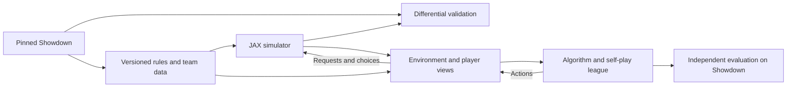

# Gen 5 Random Battles: project plan

Build a research platform that can learn exceptional Pokémon battle play through large-scale self-play, reason about concealed information, and demonstrate its strength in the actual Pokémon Showdown simulator. The platform has three independently testable construction sites: **Algorithm**, **Environment**, and **Simulator**.

The destination is a JAX implementation of the complete training computation: batched battle simulation, player observations, recurrent policy inference, trajectory collection, and learning. The current execution priority is the JAX battle simulator. Keep pinned Showdown as the semantic oracle, source of generated teams and data, and differential test harness.

As of 2026-11-06, 52 numbered tasks are accepted. The pinned reference, player-view protocol, battle runner, action/trajectory interfaces, and reproducible baseline artifacts exist. JAX has validated arithmetic, restricted one-Mew turns and complete duels, speed-tie handling, and private staged sessions with batched continuation/reset. Tasks050–051 combine Tackle/Mega Punch choices with accuracy and complete native battle traces; Task052 adds one pre-existing public burn and its residual. The legacy accuracy/burn variants retain their APIs. The approved first G3 CPU goal now adds a shared bounded roster engine with switching/pivots, statuses/items, recipient histories and resumable batched lifecycle; its native/CPU acceptance evidence is in docs/ORCHESTRATION_STATE.json. These are restricted development slices, not a complete engine or trained policy. G0 specification is accepted; G1–G8 remain open. The first G3 goal below was approved by the user on 2026-11-06, including its CPU validation scope. Execution progress is recorded in docs/ORCHESTRATION_STATE.json; approval establishes no GPU/performance result or milestone acceptance.

**Direction decision — 2026-11-03:** Prioritize an integrated, progressively playable JAX simulator. Simulator work may begin without G1 tournament completion or G2 policy learning. Keep the user-facing contract needed for correctness from the start: request and legal-action semantics, simultaneous commitments, player-visible events and history, and outcomes/rewards. Defer neural observation encoding, trajectory expansion, PPO, tournaments, and additional baseline/reporting tools unless they directly enable simulator parity or its validation. Retain exact Showdown RNG/state/event/request comparisons, interaction and full-trace testing, and explicit unsupported-effect reporting. Compile and batch representative slices early, including JIT/vmap and measured performance probes. Progress is demonstrated by increasingly complete parity-tested playable battles, not task count.

Development slices may be explicitly restricted variants while their supported mechanics are listed; they do not count as full-format support. Start validation on CPU. Require GPU runs only when a task criterion or device-specific property needs them; do not require a full GPU performance suite for every slice.

**Define the game before optimizing it.** The accepted target is Showdown's `gen5randombattle` at commit `1242c1e2d9763ba5b85d33f13aecb89bae19ae3d`, including its team generator, inherited mechanics, format clauses, requests, information disclosure, and terminal conditions. It is more specific than “Generation 5 Pokémon mechanics.” The resolved [format manifest](reference/fixtures/format-v1.json) records the Gen 5 mod, Obtainable, Sleep Clause Mod, HP Percentage Mod, Cancel Mod, Illusion Level Mod, and no Team Preview. The complete pinned source and inherited rules/data are authoritative; the manifest describes them without implementing callbacks. Version every benchmark and checkpoint against this identity. [Pinned format definition](https://github.com/smogon/pokemon-showdown/blob/1242c1e2d9763ba5b85d33f13aecb89bae19ae3d/config/formats.ts)

Success has four separate dimensions:

| Dimension | What counts as success | Evidence |
|---|---|---|
| Fidelity | The supported format behaves like pinned Showdown, including information disclosure | Differential traces, mechanics tests, request parity, explicit coverage manifest |
| Efficiency | JAX makes useful training substantially faster on available hardware | Complete pipeline benchmarks, learning curves, memory and compilation measurements |
| Strength | Agents win against a diverse, independently evaluated opponent pool | Held-out tournaments on Showdown, confidence intervals, tactical tests |
| Robustness | Gains survive new teams, opponents, seeds, and targeted exploiters | Cross-play matrices, adversarial evaluations, multiple training runs |

The moonshot is an expert or superhuman Gen 5 Random Battles agent with a reusable accelerator-native simulator and a defensible research benchmark. Neither a high self-play score nor a fast approximate simulator is sufficient evidence of that outcome.

**Use existing work as evidence and potential components.** Before choosing a simulator foundation, run a focused audit of candidates against the exact Gen 5 target. Check source availability, license compatibility, mechanics coverage, observation fidelity, tests, maintainability, and measured throughput. Similar project names do not establish shared implementations or equivalent scope.

| Project or research | What it contributes | What still needs verification |
|---|---|---|
| Pokémon Showdown | Reference mechanics, generation-specific overrides, team generation, protocol | Exact pinned revision and all inherited behavior |
| Jaxcalibur | A published example of JAX Pokémon simulation, transformer self-play, hidden-state prediction, and search | Its reported results concern a different generation; the inspected write-up does not promise released engine code |
| PokeJAX research | Evidence that accelerator-oriented Pokémon translation is an active direction | Reproducible source, relevant generation, complete mechanics coverage, and benchmark semantics |
| `JerJer2465/pokejax` | A public repository described as a Gen 4 JAX engine | Gen 5 adaptation cost and correctness; do not conflate it with the research implementation |
| `poke-env` | Python integration with Showdown and baseline players | Exact request parsing, perspective fidelity, version compatibility |
| Metamon | Pokémon trajectory modeling, offline learning, replay-processing approaches | Availability and relevance of Gen 5 Random Battles data and reconstruction assumptions |
| Pgx | JAX game-environment conventions and small imperfect-information test games | It is infrastructure inspiration, not a Pokémon simulator |

The Jaxcalibur author describes PPO self-play with a JAX engine and inference-time search; this supports the plausibility of the overall direction without establishing the best approach for Gen 5. The PokeJAX paper reports large speedups, but such figures should not become this project's targets without matching workload and fidelity. [Jaxcalibur](https://jaxcalibur.github.io/), [PokeJAX research](https://arxiv.org/abs/2603.12145), [Gen 4 repository](https://github.com/JerJer2465/pokejax)

The integration and representation audit should examine the actual available APIs and datasets. [poke-env](https://github.com/hsahovic/poke-env), [Metamon](https://github.com/UT-Austin-RPL/metamon), [Pgx](https://github.com/sotetsuk/pgx)

**Give the three construction sites a common contract.** The simulator owns battle truth and mechanical transitions. The environment owns what each player can know, what they may submit, rewards, and experience records. The algorithm owns memory, beliefs, action selection, learning, and opponent selection. No algorithm should depend on the internal layout of the simulator.



The conceptual interfaces are:

```python
# Simulator: complete state, used only inside the trusted environment.
reset(teams, battle_rng, rules) -> BattleState
advance(state, submitted_choices) -> Transition

# Transition contains state, observer-scoped events, requests,
# outcome, random-state updates, and explicit diagnostic status.
# It stops at the next externally meaningful request or terminal state.

# Environment: one knowledge state per player.
update_view(view, visible_events, private_request) -> PlayerView
encode(view, feature_config) -> Observation
action_mask(view, private_request) -> ActionMask

# Algorithm: receives only permitted player information.
act(params, observation, memory, policy_rng) -> Action, Memory, PolicyInfo
learn(train_state, trajectories) -> TrainState, Metrics
```

These are semantic contracts, not final signatures. JAX implementations use fixed-shape PyTrees, arrays, enums, and explicit masks. The Showdown adapter produces the same observation contract through its protocol. Test equivalence of the adapters before sharing a checkpoint between them.

**Construction site 1: Algorithm.** Once simulator coverage supports learning experiments, build a strong baseline before investigating equilibrium-oriented learning and planning. A complicated solver should have to beat a well-trained simpler policy under controlled evaluation.

Treat a battle as a two-player, zero-sum, partially observed stochastic game with simultaneous decisions at some requests and single-player decisions at others. A policy acts on its own observation history, not the full battle state. Both players must commit normal-turn choices without seeing the other's selection. The system must retain stochastic policies: prediction, bluffing, and mixed strategies can matter.

The research sequence is:

| Stage | Method | Why build it | Promotion criterion |
|---|---|---|---|
| A0 | Legal random, damage-oriented, and simple switching policies | Find interface bugs and establish meaningful floors | Complete battles reliably through the same player interface |
| A1 | Recurrent PPO self-play | Establish learning and measure architecture choices | Reproducible gains over baselines and historical checkpoints on Showdown |
| A2 | Opponent league plus explicit belief supervision | Reduce cycling and improve inference about concealed teams | Better cross-play and belief calibration on held-out battles |
| A3 | Regularized Nash Dynamics and population-based best-response research | Study robust mixed strategies and exploitability | Improvement under independent exploiters at matched resources |
| A4 | Belief-aware simultaneous-action search | Spend inference compute on difficult tactical decisions | Reliable gain over the same network without search |
| A5 | Search distillation and public-belief research | Convert planning into stronger fast policies and investigate deeper strategic reasoning | Improvements survive information-boundary and transfer tests |

PPO provides a practical policy-optimization starting point, not a convergence guarantee for this game. DeepNash provides motivation for testing Regularized Nash Dynamics in a large imperfect-information setting; its Stratego results do not automatically transfer to Pokémon or arbitrary neural approximations. [PPO paper](https://arxiv.org/abs/1707.06347), [DeepNash paper](https://arxiv.org/abs/2206.15378)

**Start with a structured recurrent network.** Encode the battlefield, each friendly Pokémon, each known opposing Pokémon, candidate moves, candidate switches, and recent visible events as typed entities. Use learned categorical embeddings for identities and mechanically meaningful numerical features. Attention lets actions interact with team composition and current field conditions. A recurrent memory or cached history model carries information beyond the latest observation.

Use a modest entity encoder with a GRU as the first baseline. Compare it with a transformer plus recurrent memory, then with a longer-context trajectory transformer. A reasonable experimental model-size grid is roughly 2M, 8M, and 32M parameters; these are starting proposals, not a claim that any size is optimal. Measure strength versus both environment interactions and accelerator-hours before expanding further.

Keep policy outputs tied to action entities. A move logit should depend on the move and its current user; a switch logit should depend on the candidate Pokémon and matchup. This shares useful structure across species and move combinations. Distinguish unknown, known absent, unrevealed, fainted, and unavailable values with explicit encodings.

The initial network has a masked stochastic policy head and an observation-only value head. Add auxiliary heads for unrevealed moves, items, abilities, opposing action probabilities, and outcome calibration. Hidden simulator state can supply supervised targets during training, but it cannot enter the actor's features or recurrent state. Evaluate probability calibration as well as accuracy: uncertainty is part of the decision problem.

A separate privileged critic is an optional controlled experiment. It may inspect full state to improve training estimates, but its parameters, activations, normalization statistics, and memory must not create an input path into the deployed actor. First establish a clean observation-only baseline so any gains and leakage risks are measurable.

**Make self-play a population experiment.** Maintain frozen historical checkpoints, simple specialist opponents, and independently trained agents. Sample opponents using a documented mixture of recent strength, historical diversity, and identified weaknesses. Freeze each assigned opponent for its episode; version all behavior policies in stored trajectories. Avoid updating both sides in ways that make rollout probability ratios ambiguous.

Track the full cross-play matrix. A scalar rating can conceal cycles in which one agent beats a second, loses to a third, and forgets how to beat the first. Keep a separate evaluation population that does not directly drive training. Train targeted best responses against promoted candidates, and report them as exploitability probes, not certificates of equilibrium.

Build the PPO learner with legal-action masking, recurrent sequence minibatches, burn-in or recomputed memory where appropriate, clipped updates, entropy monitoring, gradient clipping, and finite-value checks. Reconstruct recurrent state consistently during optimization; do not shuffle isolated turns and pretend they are independent. If scaling requires stale actors, explicitly measure policy lag and adopt an appropriate correction or synchronous design.

**Use terminal rewards as the reference objective.** Give each player +1 for a win, -1 for a loss, and 0 for a draw. Start with undiscounted episodic returns. A learner's rollout boundary is not a battle outcome: bootstrap from the continuing state and retain the episode's memory. Infrastructure failures are neither losses nor draws.

Damage and faint-count rewards can favor bad trades, discourage sacrifices, or create incentives to prolong battles. If shaping is explored, retain a terminal-only control and evaluate only the actual battle objective. Auxiliary prediction and curriculum tasks are preferable first experiments. Report any discounting or shaping as a change to the training objective.

**Learn beliefs that respect the team generator.** The posterior is over coherent possible teams and sets, not independent guesses for six species, four moves, an item, and an ability. Generate training examples from the pinned reference generator. Condition hypotheses on observed species, level, moves, revealed abilities/items, damage intervals, speed-order evidence, and known generation constraints.

Begin with a recurrent network that learns beliefs implicitly. Then add a finite particle representation of complete hidden configurations. Update particles with observation likelihoods, resample when weights collapse, and rejuvenate with generator-aware proposals. Track effective sample size and how often the true configuration is excluded. Treat opponent action choices as policy-dependent evidence; failure to select a move is not proof that the move is absent.

Damage evidence must account for rounded public HP and uncertain stats, items, abilities, and random rolls. Speed evidence must account for priority, effects, and ties. Illusion requires identity hypotheses rather than immediately assigning every apparent species reveal to a true team slot. Keep public history separate from any proposed hidden completion.

**Add search in increasing levels of difficulty.** The first planner estimates a joint-action payoff table over belief particles and chance samples, then computes or approximates a mixed response. A normal request has relatively few available moves and switches, making a shallow matrix calculation a useful experiment. It is only an approximation: the opponent conditions on its private information, so one universal opponent action distribution across all particles is generally insufficient.

Next, represent opponent types or information sets explicitly. Couple strategies across sampled worlds whenever a player cannot distinguish those worlds. At every simulated decision, construct that player's own view and memory; never pass the sampled full state directly into its policy. Neither side may observe the other's current committed action.

Naively solving every fully revealed sampled world and averaging the chosen actions creates strategy fusion: the planner assumes future decisions can exploit information it will never receive. Use this only as a diagnostic upper-information baseline, never as the justification for a sound deployment policy. Evaluate planning on small games where exact solutions expose such errors.

The moonshot search track is public-belief search with counterfactual values and local regret minimization, inspired by ReBeL. Learned approximate beliefs, restricted particles, limited search depth, and function approximation make this a research problem; the original method's theoretical results are not a guarantee for the proposed Pokémon implementation. [ReBeL paper](https://arxiv.org/abs/2007.13544)

Distill useful search policies into the fast actor, compare search during training with search only at inference, and allocate simulations according to decision uncertainty. Keep uncertainty calibration and information-set consistency as explicit requirements, not just win rate.

**Construction site 2: Environment.** Build the information interface with the same care as the battle engine. A simulator can have correct damage calculations and still train an invalid agent by exposing the wrong inputs.

Separate four records:

| Record | Contents | Who may consume it |
|---|---|---|
| `BattleState` | True teams, exact internal HP, hidden effects, pending actions, RNG | Simulator and explicitly privileged training/debugging code |
| `PlayerView` | Public event history plus that player's private requests and disclosures | That player's policy and belief updater |
| `BeliefState` | Inferred distributions or particles derived from that view | Policy and permitted search |
| `TrainingRecord` | Observations, masks, chosen actions, behavior probabilities, outcomes, optional labels | Learner with enforced input/target separation |

Use Showdown's player-visible streams and request objects as the observation authority. Its protocol distinguishes battle events, private choice requests, and decisions; use those distinctions directly rather than reconstructing visibility from assumptions about the cartridge game. [Showdown simulator protocol](https://raw.githubusercontent.com/smogon/pokemon-showdown/master/sim/SIM-PROTOCOL.md)

**Advance from request to request.** Do not assume one environment step is one full turn. Encode the request kind, which players must act, and which choices are already privately committed. Normal move requests, pivot replacements, faint replacements, and other interruptions require different handling. Process automatic mechanics until another external choice is needed or the battle ends.

When both players act, compute both observations before either chosen action can affect the other's view. A pending action remains private. When only one acts, the other contributes no policy action. Both players can still receive visible events and update their memory during that interval.

For learning, keep rewards and values in a fixed player's perspective. Do not negate values at every scheduler transition: consecutive requests can belong to the same player. Exclude wait/no-choice records from policy and entropy losses while preserving observations and reward propagation. If decision intervals vary and discounted experiments are added, define what elapsed quantity the discount measures.

**Use a compact request-aware action schema.** The initial singles representation reserves four move slots, six team-slot switches, and an explicit Struggle action: eleven policy slots. Active/fainted switch destinations and unavailable moves are masked from the permitted request. Forced continuation or recharge behavior is mapped according to the actual reference request, with a deterministic sole action when required. Finalize these mappings with protocol fixtures before freezing the schema.

An inactive player's WAIT is a scheduler marker, not a learnable action. No all-masked softmax is allowed: an all-masked acting request is an adapter error that must be surfaced. Do not silently substitute a random move.

Crucially, a mask represents what the player is permitted to submit based on their request, not every restriction secretly known to the simulator. Concealed trapping or other hidden restrictions can affect submission, rejection, or redisclosure behavior. Reproduce the reference request and retry semantics instead of leaking hidden facts through a perfect legality mask. Distinguish an accepted command, a rejected command, and an executed battle action.

**Encode knowledge, including uncertainty.** Candidate features include:

| Feature family | Examples and constraints |
|---|---|
| Own team | Request-visible identities, levels, HP, stats, moves/PP, items, abilities; preserve hidden internal counters as unknown when necessary |
| Opposing team | Revealed identities, apparent identities, public HP representation, observed moves, revealed item/ability, known status |
| Field and sides | Visible weather, hazards, screens, public turn count, active entities, known effect durations |
| Action context | Move type/category/power/accuracy/priority, current PP, candidate switch features, request kind |
| Temporal evidence | Visible move order, switches, failures, damage intervals, item consumption, ability disclosures |
| Beliefs | Probabilities or intervals over unknown moves, stats, sets, unrevealed members, and relevant counters |
| Derived matchups | Damage ranges and speed probabilities calculated from permitted knowledge and explicit assumptions |

Exact enemy HP, true unrevealed moves, unrevealed reserve identities, concealed duration counters, generator seed, battle RNG, and the opponent's pending action must not appear in actor inputs. Derived features are subject to the same restriction as raw fields. A perfect damage calculator using the true enemy item is still a leak.

Opponent roster entries should use encounter/reveal identity, with hypotheses for ambiguities, rather than expose hidden original slot indices. Preserve meaningful team order: order can affect mechanics. Only apply permutation augmentation when its equivalence is proven and all action mappings and order-sensitive features remain correct.

Maintain durable knowledge separately from a short event window. Truncating recent events must not erase a revealed item or known move. Recurrent training should carry state across rollout chunks and reset only when appropriate for a new episode; an opponent's newly revealed information must not reset the other player's history.

**Treat non-leakage as an executable property.** Construct pairs of full states or histories that produce the same player-visible history and request but differ in concealed information. Under the same policy RNG and permitted memory, require identical observations, masks, derived features, and action distributions. The histories must actually be observationally equivalent; changing a secret that would already have produced a visible event is not a valid test pair.

Add targeted tests for exact versus rounded HP, undisclosed items, alternate hidden reserve teams, Illusion, trapping, forced switches, and pending commitments. For search, require equal strategies across indistinguishable information sets, including at future nodes. Keep trusted-state types out of the normal policy API and run a separate trace audit of training-only labels.

**Build data and curricula without changing the final benchmark.** Partition generator seeds, full teams, battle seeds, and opponent checkpoints into train, validation, and locked test sets. Keep complete test trajectories out of replay pretraining and hyperparameter selection. Historical public replays can help, but they are not omniscient ground truth: reconstruct each player's knowledge only from what was available then, and mark uncertain labels instead of filling them from later reveals.

Use curriculum tasks to isolate competence: simple damage races; switching and hazards; setup and recovery; status and weather; PP management; incomplete information; and full random teams. Smaller teams and restricted move pools are useful diagnostic environments. They must be explicitly named variants, never silently mixed into claims about full Gen 5 Random Battles. Sample rare mechanics deliberately for testing and curriculum, while retaining the natural generator distribution for the primary evaluation.

The environment contract is small and simulator-facing: versioned requests, legal actions, player-visible events/history, simultaneous commitments, and terminal outcomes. The existing Showdown adapter and visibility tests remain the reference for these semantics. Defer expanding trajectory, baseline, and evaluation infrastructure until it is needed to validate the simulator or to begin the later learning phase.

**Construction site 3: Simulator.** Reimplement the battle execution model for accelerators while preserving the reference's semantics. A literal line-by-line translation of Showdown's object model and callback machinery is unlikely to be the best GPU design. Preserve its observable behavior, arithmetic, random decisions, and ordering through a smaller explicit execution model.

**First resolve the complete rules dependency graph.** Gen 5 is not contained entirely inside the Gen 5 directory: its inspected scripts explicitly inherit Gen 6, and its random-team class extends the Gen 6 generator. Follow inheritance through the relevant engine, data, and rules layers. Export fully resolved species, moves, abilities, items, types, and numeric parameters from the pinned reference; retain provenance for every override. Exporting data does not translate executable callbacks, which require separate implementation and validation. [Gen 5 scripts](https://raw.githubusercontent.com/smogon/pokemon-showdown/master/data/mods/gen5/scripts.ts), [Gen 5 team generator](https://github.com/smogon/pokemon-showdown/blob/master/data/random-battles/gen5/teams.ts)

Maintain a mechanics ledger with the reference implementation, generation-specific behavior, possible triggers, implementation status, and tests for each mechanic. Derive coverage from reachable interactions, not just the initial team move pools. Copied moves, called moves, transformed identities, item exchanges, and other indirect effects can expand what a random team can encounter. A finite sample of generated teams cannot prove an effect unreachable.

The first full release supports the closure of mechanics reachable in the pinned format. Every unsupported effect is explicit. Restricted-development modes may refuse unsupported battles, but their performance and strength must be labeled as restricted. Do not silently discard those teams from a full-format evaluation or turn unknown effects into no-ops.

**Represent state as fixed arrays with explicit structure.** Use a PyTree of typed arrays with a leading batch dimension. The core roster dimensions are two sides, six Pokémon per side, and four move slots per Pokémon. Keep immutable dex tables separate from mutable battle state. Encode IDs with integers and effects with fixed slots, bitsets, counters, and masks as appropriate.

State includes current and original identities where needed, stats, HP, PP, boosts, statuses, volatile effects, items, ability state, side conditions, field conditions, active slots, request state, pending choices, action ordering metadata, and RNG state. Reserve explicit representations for transformations and copied move information. Avoid embedding Python objects or strings in compiled transitions.

Event queues, visible-event buffers, and temporary effect storage require justified capacities. Where a bound is not proven sufficient, detect overflow and return a diagnostic status with a resumable state if possible. The harness must stop or resolve it through an exact reference path; it cannot drop the event or pretend the battle ended. Any fallback usage is measured and disqualifies an “entirely device-resident” throughput claim for that run.

JAX's staged computations require deliberate treatment of data-dependent shapes and control flow. Padding, masks, and structured loops make the implementation compilable, but their costs must be profiled. [JAX control-flow documentation](https://docs.jax.dev/en/latest/201/control-flow.html)

**Use an explicit event and request state machine.** Separate command acceptance from action execution. Represent move priority, speed ordering, tie-breaking, effect precedence, mid-action interruptions, faint processing, replacements, residual effects, and next-request emission as inspectable phases. A scheduler step should preserve enough state to pause and resume correctly.

Start from a readable scalar implementation using the same array schema. Compare each phase with reference traces, then vectorize. Evaluate two accelerator execution strategies: a fixed masked sequence of common phases and a bounded event interpreter. A hybrid is likely useful: fixed phases for common effects, explicit handlers for exceptional mechanics. Select the design through benchmarks and coverage, not aesthetic preference.

Avoid a giant dispatch that computes every move, ability, and item branch for every battle. Group effects into semantic primitives such as damage, healing, status application, stat modification, switching, field updates, and conditional callbacks. Reuse primitives, but retain special handlers where Gen 5 semantics demand them.

Under `vmap`, `lax.cond` over batched predicates can become selection logic that evaluates both branches. Writing a conditional does not guarantee that inactive work disappears. Profile homogeneous and heterogeneous batches, especially rare expensive effects. Bucket by phase or effect family only when the routing cost is justified. [JAX `lax.cond` documentation](https://docs.jax.dev/en/latest/_autosummary/jax.lax.cond.html)

**Make arithmetic fidelity a first-class requirement.** Implement HP, PP, stat stages, damage rounding, modifier ordering, probabilities, and integer overflow behavior to match the reference. Use integer or explicitly specified fixed-point calculations where needed. Choose intermediate widths from worst-case bounds; compact storage types need not be the arithmetic types. Neural mixed precision is independent of battle arithmetic precision.

Generation-sensitive tests should cover weather persistence, type interactions, critical hits, status behavior, move-specific effects, ability interactions, item triggers, and clauses. Build expected values from pinned reference traces and carefully reviewed mechanics cases rather than importing assumptions from a later-generation damage calculator.

**Support two randomness modes.** The default correctness mode reproduces the pinned reference PRNG algorithm, state evolution, bounded sampling, and draw consumption order. A shared numeric seed is not enough when two engines consume draws differently. If the reference requires arithmetic awkward on the GPU, implement exact limb arithmetic or another verified equivalent.

Instrument the reference to record random decisions with their context, requested range, and position in the sequence. A diagnostic random tape can drive both implementations, but it must fail when the call structure diverges; matching only successive numeric values can hide the real bug. Keep team-generation randomness, battle randomness, policy sampling, and training randomness separate and reproducible.

A later throughput-oriented mode may use JAX-native randomness after distributional validation, but it then makes a weaker equivalence claim than exact seeded trajectories. Version that choice. Seeds are never policy features. Test independence across lanes, episode resets, devices, and cloned search states.

**Treat random-team generation as part of the environment distribution.** Initially generate a large, continuously replenished stream of teams with pinned Showdown, storing complete sets, order, provenance, and generator version. Feed teams through a device-side reset pool. This lets the battle kernel and learning loop become device-resident before rewriting the irregular generator.

Sampling the same finite pool forever changes training and invites memorization. Track reuse, refresh it, and maintain separate evaluation streams. Do not replace the generator with independent species or moveset marginals: the generator includes correlated construction decisions.

The full-JAX destination includes an on-device generator if it is desired or reset throughput justifies it. Port the resolved generator logic exactly where practical. Validate seeded outputs when using compatible randomness, and separately check species/set frequencies, team correlations, levels, ordering, and rejection behavior. A learned team sampler is an optional research approximation with its own benchmark label, not an equivalent replacement by default.

The same rule applies to the overall stack: CPU-based reference testing, orchestration, file I/O, and network transport are appropriate. The performance objective is to remove host crossings from the repeated training computation. Running a WebSocket parser or writing a checkpoint in JAX adds little to that objective.

**Build a differential verification laboratory.** The lab is a central project artifact, not a late test pass. It should support replay from initial conditions, targeted state fixtures with validated invariants, first-divergence reports, and automatic reduction of failing action sequences.

| Validation layer | What is compared | Required outcome |
|---|---|---|
| Primitive | Damage, rounding, modifiers, status timers, sampling primitives | Exact agreement on reviewed boundary cases |
| Interaction | Ordered combinations of moves, abilities, items, field effects | Matching state changes and observer-scoped events |
| Request | Who acts, allowed submissions, rejection/retry behavior | Matching player-visible requests and masks |
| Trajectory | Full battles with coupled choices and randomness | No unexplained first divergence |
| Information | Equivalent player histories with different hidden states | Identical policy inputs and permissible action behavior |
| Distribution | Uncoupled simulations and generated teams | Predeclared statistical tests and sufficient sample sizes |
| Policy transfer | Same policy and opponent evaluated on both engines | Confidence interval within a predefined acceptable gap |

Canonical comparisons should include mechanically relevant hidden state in the trusted harness, not only visible logs. An incorrect counter may produce identical logs now and a different outcome later. Compare only semantically equivalent fields; irrelevant object layout or text formatting need not match.

Use property tests for HP/PP bounds, legal transitions, state persistence, replay determinism, and zero-sum outcomes. Add metamorphic tests such as player relabeling with correctly transformed RNG/tie-breaking semantics. Build interaction tests for hazards with switches and fainting, recoil with simultaneous knockouts, substitute with status moves, item loss with ability activation, and interrupted turns. Prioritize combinations actually reachable in the format, while documenting exploratory cases beyond it.

Differential fuzzing should combine random legal play, scripted tactical policies, and learned agents. Learned agents can discover simulator exploits that random play rarely triggers. Every discovered bug becomes a minimized regression fixture and a mechanics-ledger entry. Mutate selected handlers deliberately to check that the suite detects wrong priority, rounding, effect order, and visibility.

Zero observed mismatches is evidence about tested coverage, not proof of equivalence. Report battle counts, decision counts, triggered effects, pairwise interaction coverage, and untested areas. Set transfer equivalence margins before evaluation; failure to detect a statistically significant gap is not itself evidence of equivalence.

**Optimize the complete training computation.** Start with single-device execution and use `vmap` across battles and `lax.scan` across bounded rollout chunks. Keep simulator state, player memory, network parameters, and rollout buffers resident on the device. Reset completed lanes from prepared team pools, preserve terminal observations, and mask finished segments correctly. Avoid resetting every lane because one battle ends.

Sweep batch size and rollout length, then measure state memory, trajectory memory, activation memory, compiler time, and the fraction of time spent in simulation, features, inference, optimization, and resets. Structured observations or event deltas may be cheaper to store than large derived tensors. Recompute derived features only if the memory savings justify the extra work.

Benchmark three workloads separately: simulator-only execution, rollout including observation and policy inference, and complete training including optimizer updates. Report decisions per second, completed battles per second, useful non-padding work, and strength gained per accelerator-hour. A turn, a player decision, and a scheduler event are different units.

Warm up compiled functions, synchronize device completion when timing, and report compilation and steady-state measurements separately. Include ordinary and long/rare-effect battles. Compare with a properly batched CPU Showdown reference under a documented resource budget. [JAX benchmarking guidance](https://docs.jax.dev/en/latest/benchmarking.html)

Scale to multiple accelerators only after profiling a useful single-device configuration. Shard independent battles first; measure communication and opponent-parameter storage costs. Use population batching where each cohort can share a checkpoint instead of requiring a different huge model for every lane. Explore custom JAX kernels only for measured bottlenecks with an independent conformance suite.

No headline speedup is promised. Compile and batch representative simulator slices early; measure compilation, steady-state throughput, memory, and time spent in simulation and reset paths. If exact JAX execution is slow, isolate whether the cause is branching, memory bandwidth, or event scheduling before expanding the implementation. A compiled CPU engine is a comparison and possible engineering fallback, not a silent substitution for the stated full-JAX research track.

**Evaluate strength on an engine the agent cannot redefine.** Promoted agents play their scored benchmark games on pinned Showdown through the same observation adapter used for deployment. Maintain the JAX benchmark for speed and debugging, but use reference-engine results for primary capability claims.

Construct a fixed tournament suite with random and heuristic baselines, independently seeded learned policies, historical champions, style specialists, and search opponents when compatible implementations are available. Keep a locked final opponent/test set. Include curated tactical positions for switching, hazards, recovery, setup, concealment, and endgame planning.

For team variance, pair team allocations and exchange player sides across matches; repeat with independent battle seeds. This reduces some variance without making outcomes deterministic or perfectly matched. Cluster confidence intervals by paired matchup, report draws and failures, and distinguish battle-seed uncertainty from training-run uncertainty. For expensive comparisons, choose sample size from a target confidence width and a predeclared stopping rule. Use at least several independent training seeds for major claims when feasible.

Measure win rate, cross-play stability, calibration, invalid submissions, timeout rate, decision latency, and performance on rare mechanics. Freeze the opponent during best-response training and evaluate the resulting exploiter on held-out teams. A successful exploiter demonstrates a weakness; an unsuccessful one does not prove that no stronger exploiter exists.

Optional human matches and public-server play come after local transfer and latency validation, following the service's rules at that time. Pin or record the actual server version when possible and distinguish live-server format drift from the frozen benchmark. Ladder placement is supplementary evidence, not a stable reproducible research metric.

## Milestone contracts

Prepared 2026-11-06 against source base `7068c36975fbe713d55c52c2c07659cf0fcefcbb`.
Only **G0 is accepted**. Each open milestone describes its own completion
evidence; neither an internal checkpoint nor this preparation accepts one.
The configured primary works directly under [AGENTS.md](AGENTS.md), without automatic
delegation or independent review gates. No fixed dates or new wall-clock budget
are imposed. The [behavior catalog](docs/SHOWDOWN_BEHAVIOR_CASES.md) owns case
IDs, evidence levels, native probe recipes, and later case-family gaps.

The dependency order is **G0 → G3 next**, using the existing G1 reference
interface. Full G1 tournament completion and G2 learning are not prerequisites
for simulator work. G1 completion, G2 experiments, and G4 expansion may develop
alongside simulator integration conceptually; this does not require other agents.
G5 prototypes can use G3, but full-format G5/G6 claims require G4.
G6 remains useful without positive G7/G8 research results.

### G0 — frozen game specification (accepted)

- **Outcome/package:** Reproduce and identify the exact game, inherited rules/data,
  bounded custom-JAX reuse decision and known implementation gaps. Retain the lock,
  format, charter, mechanics ledger, reuse audit and [2026-11-03 acceptance](docs/reviews/G0-specification.md).
- **Dependencies/proof:** No implementation milestone. Recorded acceptance is
  authoritative; V0 rechecks pin/build and exact live format metadata. This
  preparation rechecked provenance only; it did not rerun the historical review.
- **Boundary/stop:** Specification closure is demonstrated; executable coverage
  is not. A changed pin/rule/generator requires a versioned change and affected
  evidence. No GPU, sample size, throughput or learner is required for G0.
  D2/D3 measurement decisions do not reopen it. Stop mismatched-game comparisons.

### G1 — complete reference player interface (open)

- **Outcome/package:** Run and replay complete pinned Showdown battles through
  recipient-safe views, eleven-slot actions, terminal-only rewards, decision
  trajectories and legal-random/move-first policies; reproduce a paired baseline
  comparison. Reuse the runner/trace tools instead of another reporting subsystem.
- **Dependencies:** G0 and a built pinned reference; no JAX engine or G2.
  Interface cases needed by G3 proceed now; scored tournaments stay deferred
  until they support learning.
- **Accept/evidence:** V1 and catalog protocol families cover normal/wait/forced/
  pivot requests, cancel/replacement, Struggle, rejected/unavailable choices and
  real outcomes. Both views/history must exclude opposing private requests,
  choices and training labels. Replay reproduces the outcome; rewards/masks match
  requests. Complete paired baseline runs record seeds/opponents, failures and
  uncertainty under D2. Components exist; comprehensive integration and scored
  comparison remain missing. Required proof is CPU/reference, not GPU.
- **Exclusions/stop:** No learning, simulator speed or ladder claim. Never use
  hidden restrictions to give a policy an omniscient mask. Stop on disclosure or
  request-path disagreement and establish native behavior first. D2 applies
  before scored comparisons, not before G3 parity work.

### G2 — reproducible learning proof (open, deferred)

- **Outcome/package:** Train/resume recurrent PPO through the player contract,
  retain learning curves/checkpoints and reproduce held-out improvement over a
  frozen policy on pinned Showdown. A declared G3 game permits an initial
  restricted proof with identically restricted native evaluation.
- **Dependencies:** G0, relevant G1 view/action/trajectory semantics and a runnable
  reference or accepted simulator package. This does not block G3. Reuse existing
  trajectories/baselines; recurrent model, learner and algorithm controls are new.
- **Accept/evidence:** Proposed V5 checks legal masked sampling, finite updates,
  observation-only actors, episode reset, memory across continuing rollout chunks,
  recurrent sequence/burn-in consistency and checkpoint/resume. Include a matrix
  game and a small partially observed memory task. Predeclare training seeds
  (initial proposal: three), held-out paired evaluation and confidence method;
  the lower confidence bound on native win-rate improvement over the nominated
  baseline must exceed zero. No learner or learning result currently exists.
- **Exclusions/decisions/stop:** No league, search, R-NaD, speedup or full-format
  claim. CPU controls are required; accelerator training only if selected in the
  approved experiment. Set D2/D3 before scored work. Stop on leakage, invalid
  resumption, non-finite updates or insufficient evidence; reward alone is not proof.

### G3 — integrated playable simulator package (open, next)

- **Outcome/package:** Play/resume a declared multi-Pokémon singles slice through
  one shared state, request/action scheduler, event projection, RNG trace and
  scalar/compiled batched API. A manifest defines teams, mechanics and bounds;
  unsupported behavior has explicit diagnostics. The first goal below is its
  substantial CPU integration package.
- **Dependencies/reuse:** G0 and existing G1 oracle/player contracts, not G1
  tournaments or G2. Reuse arithmetic, native RNG observation, action/protocol
  adapters and full-trace expectations; migrate variant-specific assumptions below.
- **Accept/evidence:** All required B0–B5 cases need independent native or labeled
  synthetic expectations; exact state/PP/status/order/RNG/request/event/outcome
  comparisons; full native terminal traces; information-equivalence tests; and
  CPU eager/JIT/heterogeneous-batch agreement through continuation/reset (V2–V4).
  Closing **G3 itself** additionally requires V6 on an agreed GPU: actual device
  placement, exact compiled batch correctness and synchronized compile/warm
  execution/memory profiles for homogeneous and heterogeneous workloads. Report
  results without inventing a speed threshold. Historical arithmetic GPU evidence
  does not establish current engine execution.
- **Demonstrated/missing:** Tasks034–052 establish the retained legacy controls.
  The first approved G3 goal now passes the shared roster/status/pivot CPU
  integration and native complete-trace/lifecycle acceptance recorded in
  [compact state](docs/ORCHESTRATION_STATE.json). Earlier GPU parity and intermediate
  profiling are preserved in the G3 results report. Matching-source GPU acceptance
  of the current engine/lean API and the bounded V6 measurements remain deferred
  during travel; exact commands and closure checks are in the
  [shared GPU handoff](docs/GPU_HANDOFF.md#g3-closure-remaining-obligations-and-bounded-commands).
- **Exclusions/decisions/stop:** No full-format, generated-team, training or
  speedup claim. First-goal CPU completion can leave G3 open pending D3 device
  proof. Stop on an unresolved minimized divergence, unsupported approved behavior,
  capacity failure or unavailable required device evidence; never shrink scope
  to manufacture completion.

### G4 — complete pinned-format simulator (open)

- **Outcome/package:** Execute the complete pinned `gen5randombattle` distribution
  in JAX with all reachable inherited mechanics, requests, clauses and outcomes.
  Keep a reachable-rule/data/callback ledger, minimized regression corpus,
  coupled full-game harness and differential fuzzing.
- **Dependencies:** G3 shared engine and G0 target. Reachability/data export and
  team integration can progress alongside G3; G5 prototypes may reveal gaps.
  Versioned, refreshed reference-generated teams are permitted. JAX team generation
  is an optimization, not a prerequisite.
- **Accept/evidence:** Proposed V7 audits copied/called moves, transformations,
  exchanged items and inherited callbacks, with every reachable ledger entry
  implemented and linked to cases. Include six-member generated teams,
  forced/pivot/recharge requests, sleep/freeze/duration, hazards/weather,
  trapping/Illusion and terminal clauses. Freeze regression and held-out seeded
  campaigns; require no known reachable unsupported entry, unresolved divergence
  or silent fallback. CPU and GPU batch correctness are required for release.
  Sampling alone does not establish completeness; this evidence is missing.
- **Exclusions/decisions/stop:** No trained strength or useful training speedup.
  The proposed CPU goal below fixes conformance campaign sizes and stop rules;
  D2 scored research and D3 GPU resources remain separate decisions. Unknown
  reachability stays a gap; an unsupported reachable effect blocks acceptance
  rather than removing the battle from evaluation.
  See [the proposed G4 CPU execution brief](#proposed-g4-cpu-implementation-and-conformance-goal).
  During travel, accumulate device checks and ready/pending commands in the
  [shared GPU handoff](docs/GPU_HANDOFF.md); GPU execution remains deferred while
  CPU implementation continues. Results must match their recorded source.

### G5 — useful end-to-end training system (open)

- **Outcome/package:** Collect device-resident battles with safe features,
  recurrent inference, reset pools and PPO updates; save/resume and measure useful
  learning against a matched reference pipeline. Separate simulator-only,
  rollout-plus-policy and learner/end-to-end workloads.
- **Dependencies:** G2 learning proof, G1 contract and G4 for full-format claims.
  Prototype collection/compilation on G3 earlier with restricted labeling.
- **Accept/evidence:** Proposed V8 checks same-policy JAX/Showdown transfer on
  paired held-out teams within a predeclared equivalence margin, input isolation,
  memory/reset behavior and restart. Actual accelerator evidence must report
  compile time, synchronized warmed throughput, memory, reset/feature/inference/
  learner cost and fallback/host crossings. Require a declared useful improvement
  in end-to-end cost/time to the selected held-out strength target, rather than
  arithmetic speed alone. Pipeline, transfer and performance proof are missing.
- **Exclusions/decisions/stop:** Multi-device scaling, JAX team generation and
  search are optional. D2/D3 fix transfer margin, minimum useful gain, workload,
  hardware and resource budget before measurement. Stop on transfer failure or
  hidden fallback. Missing required GPU proof stays `awaiting_gpu` with exact
  source identity, commands and existing CPU evidence.

### G6 — strong, robust recurrent baseline (open)

- **Outcome/package:** Promote a recurrent PPO/league agent that reliably beats
  the G2 baseline and nominated historical checkpoints on independent pinned
  Showdown evaluation; retain checkpoints, cross-play and belief/league ablations.
- **Dependencies:** G5 and G4 for the full format. Restricted architecture/league
  experiments can begin earlier but do not establish full-format G6 strength.
- **Accept/evidence:** Proposed V9 uses independent training runs (initial
  proposal: at least three), paired held-out teams/seeds, frozen diverse opponents
  and tactical/rare-mechanic cases. Predeclare promotion effect size, confidence
  method and failure/latency limits. The confidence bound must clear that threshold;
  disclose cross-play regressions/cycles, calibration and resource use. Compare
  league/belief contributions to matched controls. Native evaluation and actual
  training/device provenance are required; no learned-strength evidence exists.
- **Exclusions/decisions/stop:** No equilibrium, human/superhuman or search claim.
  Set D2/D3 before scored runs. Stop promotion on unexplained transfer loss,
  test-set reuse or unacceptable forgetting; self-play rating alone is insufficient.

### G7 — strategic method with controlled benefit (open)

- **Outcome/package:** A selected R-NaD, best-response, explicit-belief or
  simultaneous-search method improves G6 at declared resources. Choose one
  comparison under D4 rather than implementing every method as a prerequisite;
  retain ablations, checkpoints and exploiter results.
- **Dependencies:** A frozen G6 control, and G4/G5 for full-format experiments.
  Small-game solver/information-set checks can proceed independently of large
  training. Implementations and all research proof are missing.
- **Accept/evidence:** Proposed V10 checks matrix/memory games, stochastic mixed
  decisions and observation-consistent future strategies. Compare the same
  checkpoint with/without search or matched-budget training methods; report
  native held-out gain, belief calibration/particle collapse where applicable,
  latency and training/inference cost. Train independent best responses and
  evaluate them held out. Benefit must clear declared uncertainty/cost thresholds;
  a failed exploiter is not a Nash certificate. CPU semantic checks and actual
  chosen training/search-device evidence are required.
- **Exclusions/decisions/stop:** No promised positive result or public-belief
  moonshot. A negative result closes an experiment, not the beneficial-method
  milestone; D4 governs a new direction. Stop on strategy fusion, private actor
  inputs or a resource requirement beyond the approved research scope.

### G8 — audited moonshot candidate and reproducible release (open)

- **Outcome/package:** Combine beneficial public-belief planning, distillation
  and adaptive inference compute into the best verified candidate in the explored
  design space. Supply reproducible source/configurations, checkpoint identities,
  rules/schema/model provenance, inference interface and audit/benchmark report.
- **Dependencies:** G4–G6; promoted G7 components retain their own proof. Release
  design can proceed earlier. No public-belief implementation, candidate or
  release result exists today.
- **Accept/evidence:** Proposed V11 replays/resumes the candidate, demonstrates
  future information-set consistency and search/distillation/compute ablations,
  and compares against frozen best G6/G7 controls on locked native evaluations
  within declared latency/resources. Report paired uncertainty, exploiters,
  failures and multiple training runs for major claims. Actual deployment-device
  measurements and a complete reproducibility manifest are required. Strongest
  means strongest among the evaluated controls/design space.
- **Exclusions/decisions/stop:** No automatic expert/superhuman/global-optimum or
  ladder claim. Human comparisons need a defined independent comparison; public
  server play/publication are separately scoped. D4 selects the research objective;
  D5 settles release audience/license/resources. Stop on failed reproducibility,
  provenance, information integrity or claimed improvement.

## Proposed first G3 Goal-mode brief

**Outcome:** Initialize, play, pause, resume and reset bounded 1–3 Pokémon-per-side
Gen 5 singles battles through one shared JAX engine, including voluntary switches,
native forced replacements and U-turn interruptions, with both player views and
exact pinned native differential traces. This is a restricted custom game, not
the `gen5randombattle` team distribution. The user approved this brief and its CPU validation scope on 2026-11-06.
The completed CPU goal `G3-first-playable` is preserved in
[compact state](docs/ORCHESTRATION_STATE.json); the current package is recorded
in the active approved section below.

**Declared package:** A versioned allowlist of Mew/Synchronize,
Snorlax/Immunity and Gengar/Levitate; itemless, Leftovers and Lum Berry; up to
four slots from Tackle, Pound (legacy migration), Mega Punch, Earthquake, U-turn,
Will-O-Wisp, Toxic, Thunder Wave, Recover and Protect, plus forced Struggle.
Support burn, paralysis and bad poison application/failure/reflection, cure,
residual/counter and switching interactions. Direct native execution proves
behavior for supplied sets; it does not establish generator membership or
validate arbitrary move/species combinations.

Initial set domain: levels 1–100, Hardy nature, perfect IVs, zero EVs except
Speed EVs of 0 or 252, no initial boosts, and native resolved types/stats.
Trusted HP/PP/status boundary fixtures are separately labeled. General nature,
EV, boost, species and set-distribution expansion belongs to later packages.

Use six roster storage slots and four move slots, with unused positions masked
and at most three occupied roster slots in this goal. Keep stable internal mon
identity separate from native request slot order: switches reorder that roster.
Include normal/forced/wait/terminal phases, pending opposing actions across
pivots, priority/speed ties, PP depletion, recoil, terminal rewards (+1/-1/0),
and recipient history. Support native pre-resolution choice replacement/cancel
where permitted. Old sessions' duplicate rejection is a local wrapper contract,
not Showdown Cancel Mod semantics; local episode tokens are not native `rqid`.

**Architecture/migration:** `TwoMoveState` fixes two Mew and two shared move IDs;
v6 requires unequal speeds; v7 adds at most one burn; sessions dispatch to v2/v4.
These layouts cannot become a shared roster engine merely by adding variant IDs.
Reuse int32 arithmetic and explicit PRNG recurrence, generalize action/order/RNG
tracing, and introduce one roster/request/queue state with per-mon PP/status/items,
active indices, pending choices, counters and bounded event buffers. Reuse
`projectPackets` and eleven-slot action mapping as reference contracts. Extend
one native case runner with phase-aware snapshots and independent expected-data
readers. Its current observer captures extra scheduler draws but labels new
status/stall contexts `unsupported`; generalize labels without resampling draws.

Migrate Tackle/Pound/accuracy/burn and staged lifecycle cases to that harness.
Retain old public APIs and native expectations as compatibility controls until
shared-engine coverage passes. Later retirement may remove redundant adapters/
oracles after a coverage map and explicit cleanup scope; no cleanup occurs now.

**Exclusions:** Six-member/full-format support, generated-team filtering,
sleep/freeze/confusion/ordinary-poison infliction, weather/hazards, trapping,
Illusion/Transform/called moves, effects outside the allowlist, neural encoding,
PPO/league/tournaments, device-resident reset pools, JAX team generation and a
throughput target. Entry handling here covers status persistence, counters and
native ability/item updates; hazards and other entry effects are adjacent G4 work.

**Integration checkpoints — one goal, no numbered tasks:**

1. Establish the shared manifest/state/case schema and independently reproduce
   B0/B1 legacy state/draw/view expectations and native initialization RNG. Handle
   mixed moves and tied/unequal-speed batches without a state/variant per move.
2. Complete the request scheduler through voluntary switch, faint replacement,
   U-turn pause/resume, permitted cancel/replacement, both submission orders,
   stable identity/request-slot mapping and recipient-safe history (B3/B4).
3. Integrate B2 status, Protect/recovery, abilities/items, residual ordering,
   exhaustion/Struggle and outcomes into the same engine. Diagnose unsupported
   effects and capacity bounds explicitly (B1/B2/B4).
4. Finish B5 scripted native battles to real outcomes and deterministic split
   continuation/reset, then the same cases in heterogeneous CPU `jit(vmap(...))`
   batches. Inspect the diff and retain first-divergence diagnostics and exact
   relevant source/tree identity with evidence.

**Acceptance/validation:** B0–B5 is the required matrix; independently observe
each proposed native expectation before asserting JAX parity. Run V0–V4 affected
checks, including shared interaction/full-battle/lifecycle modules and affected
legacy regressions. Native expectations never come from JAX. Compare exact
numeric state, draw bounds/values/pre/post limbs, queue/requests, both views and
outcomes; normalize only documented nonsemantic timing/stack paths. Require at
least four complete three-member native battles over both seats and multiple
seeds: direct-KO replacements, status/item continuation, pivot resume and an
exhaustion/recoil ending. Coverage summaries must exercise every required family
or point to its companion boundary case; empty coverage fails.

The proposed goal includes potentially long affected CPU integration/regression
runs once implemented. Historical logs took about 512 seconds for 21 legacy
tests; those logs do not establish current runtime/provenance. Do not rerun all
history by habit. No long suite, GPU run or performance experiment belongs to
this preparation. First-goal completion requires CPU integration proof; GPU
correctness/profile V6 remains a required later G3 closure step under D3.

**Stop/checkpoint:** Preserve unaccepted work, minimized input, pin, source
identity, exact command/result and first divergence if native behavior contradicts
the design. Ordinary repairs/oracle clarification stay within the goal. Seek user
input when resolution changes the approved game/package, needs an excluded
mechanic or changes device/research scope. Preflight unsupported inputs without
RNG consumption; on buffer/queue overflow return a diagnostic and unchanged
pre-advance state, with no partial public events or invented outcome. A harness
step/turn cap is truncation, never a draw. Never remove a required family or
label pending evidence passed.

## Validation entry points and remaining decisions

Commands below are **entry points, not results of this preparation**. Run from
the repository root with the guarded pinned reference built. Set `JAX_PYTHON`
to an installed interpreter with compatible JAX/JAXLIB; historical `/tmp` paths
are not portable. Existing means the entry point is present, not that its
dependencies or all acceptance cases are complete.

| ID | Exact entry point | Status and use |
|---|---|---|
| V0 | `node reference/oracle.cjs provenance`; `node reference/oracle.cjs format`; `node --test test/reference.test.cjs` | Existing pin/build and live format equality. G0 maintenance/all native work. |
| V1 | `node --test test/protocol.test.cjs test/action-space.test.cjs test/battle-runner.test.cjs test/trace.test.cjs test/decision-trajectories.test.cjs test/baseline-matchup.test.cjs` | Existing G1 contracts; protocol-family additions remain needed. Scored runs reuse `node environment/run-baseline-matchup.cjs --root-seed 1,2,3,4 --pair-index 0 --policy-a legal-random-v1 --policy-b move-first-v1 --output NEW_FILE` under D2, not one smoke pair as a tournament. |
| V2 | `node reference/accuracy-choice-oracle.cjs`; `node reference/accuracy-choice-oracle.cjs --duels`; `node reference/burn-choice-oracle.cjs` | Existing native B0–B2 anchors. Catalog appendix reproduces additional short probes. |
| V3 | `JAX_PLATFORMS=cpu "$JAX_PYTHON" -m unittest test.test_accuracy_choice test.test_accuracy_choice_duel test.test_burn_choice test.test_two_move_session_duel test.test_request_session_batch test.test_two_move_session_reset -v` | Existing migration/lifecycle controls; may be long. Add changed-helper legacy tests, including known-long `test.test_neutral_two_move` if its dependencies change. |
| V4 | `node reference/shared-engine-cases.cjs --batch all --output NEW_FILE`; `JAX_PLATFORMS=cpu "$JAX_PYTHON" -m unittest test.test_shared_engine_cases test.test_shared_engine_battles test.test_shared_engine_lifecycle -v` | **Implemented.** One family-batched native runner and shared CPU case/battle/lifecycle modules, B0–B5; current evidence/status is in compact state. |
| V5 | `JAX_PLATFORMS=cpu "$JAX_PYTHON" -m unittest test.test_recurrent_ppo_contract test.test_small_game_learning -v`; `"$JAX_PYTHON" -m training.run --config APPROVED_CONFIG`; `"$JAX_PYTHON" -m evaluation.learning_proof --config APPROVED_CONFIG` | **Proposed, absent.** G2 controls, learning and native held-out proof. |
| V6 | `"$JAX_PYTHON" scripts/g4_gpu_handoff.py` plus the bounded two-cohort block in [GPU_HANDOFF.md](docs/GPU_HANDOFF.md#g3-closure-remaining-obligations-and-bounded-commands) | **Commands prepared; execution deferred during travel.** Current CPU/CUDA correctness including lean API, then homogeneous/mixed batch 32, chunk 8 compilation/warm execution/memory evidence. No broad sweep or ablations; agent audits G3 closure against matching-source results. |
| V7 | `JAX_PLATFORMS=cpu "$JAX_PYTHON" -m evaluation.full_format_conformance --config evaluation/g4-cpu-v1.json --suite acceptance --output NEW_DIR` | **Pending; module absent, fixed config present.** Inventory/data export and generic schema are in progress. Implement the remaining inventory, regression and fixed development/held-out CPU gates below. GPU conformance remains a separately authorized release requirement. |
| V8 | `"$JAX_PYTHON" -m benchmarks.training_pipeline --config APPROVED_CONFIG`; `"$JAX_PYTHON" -m evaluation.policy_transfer --config APPROVED_CONFIG` | **Proposed, absent.** G5 matched workloads, device measurements and transfer equivalence. |
| V9 | `"$JAX_PYTHON" -m evaluation.baseline_promotion --config APPROVED_CONFIG` | **Proposed, absent.** G6 multi-run native promotion/cross-play/ablations. |
| V10 | `"$JAX_PYTHON" -m evaluation.strategic_ablation --config APPROVED_CONFIG`; `"$JAX_PYTHON" -m evaluation.information_set_tests --config APPROVED_CONFIG` | **Proposed, absent.** G7 controls, exploiters and future information-set consistency. |
| V11 | `"$JAX_PYTHON" -m evaluation.release_audit --config APPROVED_CONFIG` | **Proposed, absent.** G8 release replay/resume, locked evaluation and inference-resource audit. |

Decisions below apply when they affect the work, rather than requiring user
permission for ordinary implementation choices.

| Decision | Proposed default and when user input is needed |
|---|---|
| D1 — first goal | Approve the integrated CPU-first G3 package above, then select Sol 6.1/high Goal mode on the execution surface. Approved by the user on 2026-11-06, including CPU validation; direct execution is active. Execution-surface mode remains external to repository configuration. |
| D2 — scored research protocol | Before G1 scored tournaments or G2/G5–G8 claims, agree opponents/metrics, suites/seed publication, sample precision, promotion/equivalence margins and statistical stopping rules. Does not reopen G0 or block G3 parity. |
| D3 — accelerator/resources | Before required G3 device closure or later training/performance runs, select available GPU, memory/batch limits and measurement/training resources. Default first goal: CPU proof, G3 still open. |
| D4 — strategic objective | At G7/G8 choose the research comparison and useful strength-versus-latency/cost target using G6 evidence, rather than committing to every speculative method now. |
| D5 — release | At G8 agree audience, checkpoint/data licensing and hosting/publication scope. No external publication/server play is part of this preparation. |

Routine choices resolved here: one shared engine/harness, explicit custom teams,
reference-generated teams for later full-format work, CPU-first proof, retained
legacy controls, and no new independent-review gate. Missing native interactions
are catalog evidence work within the proposed goal, not user preferences.


**Keep experiments discriminating.** Every expensive run should answer a question that changes the design. Begin with the following comparisons:

| Question | Controlled comparison | Decision it informs |
|---|---|---|
| Does memory matter? | Feed-forward versus recurrent policy with equalized capacity | Minimum architecture and history handling |
| Are handcrafted matchup features worth their cost? | Raw structured state versus permitted damage/speed features | Feature pipeline complexity and throughput |
| Do explicit beliefs improve decisions? | Implicit memory versus auxiliary prediction versus particles | Whether belief machinery belongs in deployment |
| Is more model capacity worthwhile? | Size sweeps at matched interactions and matched accelerator-hours | Scaling strategy |
| Does a league reduce cycling? | Latest-self-play versus checkpoint mixture versus population selection | Opponent infrastructure |
| Does equilibrium-oriented learning help? | PPO versus R-NaD with comparable representation and compute | Main learning algorithm |
| Does planning add robust strength? | Same checkpoint with no search, shallow matrix search, deeper belief-aware search | Inference compute and search investment |
| Does privileged training help safely? | Observation critic versus isolated full-state critic | Training-only information use |
| Does replay pretraining transfer? | Self-play from scratch versus matched pretraining variants | Data investment and initialization |

For each comparison record the primary metric, evaluation set, compute accounting, uncertainty, and promotion criterion before running it. Keep a small permanent sanity suite of matrix games and partially observed games with known solutions for debugging mixed strategies, memory, and search independently of Pokémon mechanics.

**Organize implementation around ownership and artifacts.** A proposed repository layout is:

```text
reference/        # Pinned Showdown dependency, oracle instrumentation, exports
rules/            # Versioned format manifest and compiled immutable tables
simulator/        # State, arithmetic, scheduler, effects, RNG, batched kernels
environment/      # Player views, requests, encodings, actions, rewards, adapters
agents/           # Baselines, networks, memory, beliefs, planners
training/         # PPO, R-NaD experiments, league, rollout, distributed execution
evaluation/       # Reference tournaments, confidence intervals, tactical suites
tests/            # Mechanics, interactions, differential, visibility, regressions
benchmarks/       # Simulator, rollout, end-to-end training, memory/compile profiles
experiments/      # Versioned configurations and machine-readable run manifests
docs/             # Contracts, mechanics ledger, decisions, benchmark reports
```

Each checkpoint records model/optimizer state, training RNGs, relevant episode state or restart policy, league composition, rules hash, Showdown commit, feature/action schema versions, generator provenance, software versions, and experiment configuration. Test resumption rather than assuming that saving network weights reproduces training. Store large datasets and checkpoints outside Git with immutable identifiers.

Use fast deterministic checks for every change, larger interaction/differential suites for mechanics changes, and full transfer/performance runs for release candidates. Continuous integration should catch schema changes, visibility regressions, unsupported effects, and failed fixtures before they contaminate expensive training. Keep deliberate schema migrations and compatibility errors readable.

**Address the largest risks with concrete exit routes.**

| Risk | Early signal | Response |
|---|---|---|
| Long tail of mechanical bugs | Trace mismatches cluster around rare combinations | Expand event tracing and minimized fixtures; delay full-format claims |
| Hidden-information leakage | Equivalent histories produce different features or policies | Repair the view boundary; invalidate affected comparisons and retrain where needed |
| JAX compilation or branching overwhelms gains | Large compile times, poor useful throughput | Profile and restructure phases, tables, dispatch, or batch cohorts |
| Policies exploit simulator errors | JAX strength fails to transfer to Showdown | Localize first divergences under learned play; repair and repeat evaluation |
| Self-play cycles | New checkpoints lose to old specialists | Expand historical population and targeted best-response training |
| Beliefs exclude the true hidden state | Particle collapse or overconfident wrong predictions | Improve proposals, retain uncertainty, calibrate on held-out traces |
| Search invents knowledge | Different actions at indistinguishable simulated histories | Enforce information-set coupling; return to a simpler valid planner |
| Generator or server drifts | Updated teams/rules change results | Freeze old benchmark; publish a new version and explicit transfer study |
| Resource use grows without strength | Larger runs only improve training reward or raw throughput | Revisit representation, evaluation, and bottlenecks before scaling |

**The active implementation goal is G4 CPU implementation and conformance below.** The user assigned sustained CPU execution on 2026-11-08. The bounded roster/hazard package remains CPU-complete; current generic data/mechanics progress and remaining gates are in compact state. Baseline tournaments, learning and additional performance runs remain deferred.

The long-term research opportunity is the combination: a faithful accelerator-native battle engine enables enormous self-play; an exact information interface makes those experiences legitimate; and a strong learning system can use both training compute and inference compute to discover strategies. All three construction sites should remain independently inspectable so that a gain in one can be trusted by the others.

## Active approved package: six-member rosters and entry hazards

The user approved both lean-rollout CPU validation and this bounded G4 package
on 2026-11-07. The rollout checks passed (10 tests, 149.109s, source `bda1df1`);
see `test-logs/g4-roster-hazards/lean-rollout-cpu.log`.

Expand the existing custom-game domain to one through six members per side,
Stealth Rock, one through three Spikes layers and Gen 5 Rapid Spin removal.
Preserve stable identities, command order, exact RNG, requests, both recipient
event histories, continuation/reset and lean/full rollout agreement. Establish
pinned native family behavior first, including placement/repeat failures,
Levitate, insertion order, switch/pivot entry KOs, removal blocked by Ghost or
Protect, and complete six-member native battles. Validate on CPU with eager/JIT
and mixed batches; stop on an unresolved minimized mismatch or capacity limit.

Keep existing species, stats, abilities, items and status scope. Toxic Spikes,
ordinary poison and the remaining G4 families are deferred. This package does
not close full-format G4. GPU testing, benchmarks, profiling, learning and
large fuzz campaigns are excluded. Commit/push the coherent validated package.

**CPU acceptance:** complete on source `2982555`: 26 checks passed in 492.679s,
including all 22 new native scenarios / 408 boundaries and four complete
six-member battles, existing 111 scenarios / 464 boundaries, eager/JIT/mixed
batches, lean/full rollouts, saved continuation/reset, privacy and atomic
rejection/capacity behavior. Two native protocol checks also passed. The final
native metadata follow-up reports schema 2 for individual G4 case selections;
it changes no fixture semantics or engine source. Exact commands, source hashes
and logs are in `test-logs/g4-roster-hazards/` and compact state. The bounded
package is accepted; full-format G4 and new GPU/performance validation stay open.

## Proposed G4 CPU implementation and conformance goal

**Status:** approved by the user and assigned for sustained CPU execution on
2026-11-08 against `f37067e`, including integrated checkpoints and commit/push.
Current progress and remaining gates are in `docs/ORCHESTRATION_STATE.json`. Existing
G0 acceptance and completed G3/G4 CPU packages remain intact. G1/G2/G3 and full
G4 milestone status do not change. The earlier roster/hazard section records a
completed package, not the scope ceiling for this proposed goal.

**Outcome:** Run the complete pinned `gen5randombattle` distribution through the
shared JAX engine on CPU, from reference-generated six-member teams through
native terminal outcomes, with exact state/RNG/request/recipient-history parity.
This is one sustained implementation goal with integrated checkpoints. It is
not another restricted species or move allowlist. Full G4 acceptance still needs
later GPU correctness on the relevant source; CPU completion cannot close G4.

**Target and reuse:** Pin `1242c1e2d9763ba5b85d33f13aecb89bae19ae3d`, format
`gen5randombattle`, resolved `gen5 -> gen6 -> gen7 -> gen8 -> base` mechanics,
no Team Preview, and the exact effective rules in
`reference/fixtures/format-v1.json`. Reuse the shared state/scheduler, exact PRNG,
arithmetic kernels, native observer/case reader, player projection, rollout and
lifecycle contracts. Reuse `environment/prepared-teams.cjs` and
`environment/paired-seeds.cjs` for pinned teams and independent seed streams.
Showdown may export data, generate teams and produce independent expectations;
JAX transitions must not call native simulation or use Python effect fallbacks.
Retain frozen schema 1/2 contracts and evidence; version expanded tables, state,
serialization and bounds explicitly. Required request/protocol changes belong
in this goal without claiming completion of unrelated G1 work.

The 2026-11-13 scope audit precedes further mechanic implementation. Use the
[reachability precheck](docs/SHOWDOWN_BEHAVIOR_CASES.md#reachability-audit-and-family-precheck-2026-11-13)
before each family; preserve unresolved dependencies and all final acceptance.

### Inventory and implementation scope

The [G4 inventory and behavior contract](docs/SHOWDOWN_BEHAVIOR_CASES.md#proposed-g4-cpu-inventory-and-behavior-contract)
is the source of family/case coverage. Static inspection found **388 set-file
species/form entries, 605 role sets, 230 movepool IDs and 127 distinct ability
labels**. These are candidate roots, not a reachability proof or coverage score.
The first checkpoint must resolve generator eligibility, item selection,
forms/stat variations and inherited callbacks, then close dependencies through
called/copied moves, Transform, changed abilities and exchanged/created items.

During implementation create one versioned machine-readable ledger, proposed
`rules/gen5-reachable-v1.json`: pin/source hashes, canonical data/effect IDs,
resolved defining file/callback, reachability edge/precondition, implementation
mapping, native witness or reasoned exclusion, and tests/evidence. Represent
candidates, unresolved entries, implemented-but-unvalidated entries and validated
entries separately. Unknown reachability stays open; conservative implementation
is allowed, unsupported behavior or sampling is not proof of unreachability.
Record a source-backed exclusion when a branch cannot occur in this format.
The ledger must cover transitive effects and scheduler/rule behavior, not just
names in generated teams. Audit capacities against target turn/action/event
limits, including the native turn-limit outcome and visible warnings; schema 2's
2048-row history is an existing bound, not full-format acceptance evidence.

Scope includes all reachable species/forms/types/stats and generator set values;
physical/special/variable damage and accuracy/critical modifiers; boosts, weather,
screens, remaining hazards, statuses/durations and clauses; ability/item hooks;
trapping/phazing/locks/recharge/multi-turn/multi-hit/Substitute/recoil/drain;
Illusion/Transform/called moves/item exchange; every resulting phase, request,
visibility, RNG and terminal interaction. Establish native behavior by family
before implementation, adding interaction cases when dependencies meet. Native
source inference without an observed case remains labeled provisional.
Use parameterized cases for shared behavior plus a complete data/handler audit;
exhaustive battle histories and all combinations of effects are not required.

### Acceptance and bounded CPU validation

**Implementation order, updated 2026-11-14:** Plan small work packages of two to
four related reachable mechanic families. Establish native expectations per
member, implement in dependency order, and run all members' exact focused CPU cases
through one shared compiled step at the group checkpoint. Keep CPU evidence
pending until that group passes. Use persistent caching for unchanged-source
correctness reruns, preserve memory-safe process isolation, and stop on a
divergence before adding further families. Follow the
[compilation-aware workflow](docs/ORCHESTRATION.md#compilation-aware-g4-checkpoints).
Compact state owns the current next package, scope and resume command; completed
packages are historical evidence. Continue between passed group checkpoints
within sustained authorization. Do not launch speculative optimization sweeps.
GPU correctness, broad CPU matrices, complete-battle campaigns and profiling
remain deferred until reachable mechanics and inventory closure are complete.
The gates below remain required; deferred commands live in
[GPU_HANDOFF.md](docs/GPU_HANDOFF.md).

All conditions below are required; never replace a failed start, drop a reachable
family, weaken equality or turn a harness cap into a native draw.

| Gate | Observable pass condition |
|---|---|
| Inventory | Every reachable data/effect/rule entry maps to implementation and independent evidence; zero unresolved reachability, unsupported callbacks or unvalidated required entries. A documented proof excludes each discarded candidate. |
| Directed regression | Retain the 111 legacy shared scenarios / 464 boundaries and 22 roster/hazard scenarios / 408 boundaries. Add native ordinary, boundary/failure and reachable interaction cases for each new behavior; cover its reachable behavioral branches or give a proof they cannot occur. Include generated-set initialization and data equality across candidate roots resolved as reachable. Freeze exact case IDs, source/fixture digests and per-case labels before the final gate. Synthetic installations remain labeled and do not prove generator membership. |
| Exact differential contract | Compare complete mechanically relevant native state, dynamic effects/counters, speed/order and suspended queue; initialization and every ordered draw argument/value/pre/post RNG; requests, legal/available/rejected choices, private commitments; both recipient histories; terminal result/rewards at every request boundary. Expand capture/projection for new fields before claiming parity. Normalize only documented timing/diagnostic paths. |
| Execution/lifecycle | Directed cases agree in CPU eager/JIT and mixed `jit(vmap)` batches of 1, 8 and 32. Replay generated complete traces in scalar JIT and heterogeneous 8/32-lane batches, with absorbing padding counted as no work. Save/restore representative ordinary, pending, forced, pivot, locked/recharge and transformed states; verify reset, per-lane RNG isolation, privacy and atomic invalid/stale/unsupported/overflow behavior. Full and lean rollouts agree on final state/status and requested outputs. |
| Fixed campaigns | All 64 development and 128 held-out starts defined below reach the same genuine native terminal, with every boundary equal. Zero simulation errors, unresolved divergences, required capacity failures or truncations. Native initialization/generator failures are reported, not silently replaced. Campaign sampling complements the inventory audit and cannot establish complete coverage alone. |
| Reviewable finish | Primary inspects the diff and ledger, records exact source/pin/environment/commands/results and remaining GPU evidence, commits/pushes coherent work. Only after all CPU gates pass record `G4-CPU-conformance` complete; leave full G4 open. No independent reviewer or task-count ceremony. |

`evaluation/g4-cpu-v1.json` now records these fixed settings. The executable
conformance gate is still pending; this is a conformance configuration, not a
benchmark. Reuse paired-seed derivation `sha256-json-domain-v1` unchanged:

| Suite | Root seed | Pair indices | Seats and policies | Starts |
|---|---|---|---|---:|
| Development | `[2026,11,8,41]` | 0..31 | Both seats of each pair; even indices use `legal-random-v1` for both actors, odd indices `move-first-v1` for both | 64 |
| Held-out | `[2026,11,8,42]` | 0..63 | Same deterministic policy assignment and both seats; disjoint team/battle/policy seed identities | 128 |

Use the existing policies in `environment/random-policy.cjs` and
`environment/move-first-policy.cjs`, extending only for newly required request
semantics. Policy inputs are recipient histories/own requests, never trusted
opposing state or battle RNG; policy RNG is separate. For each native run,
record choices and exact generated packed-team identities once and replay those
choices in JAX; assert matching views and legality before each submission.
Seat mirroring does not assume mirrored outcomes or RNG streams.

Cap each start at **4096 resolved request boundaries**, and cap retried invalid
submissions at **16 per request**; valid ordinary submissions should need no
retry. Hitting either cap is a reported unresolved truncation/error, not a pass.
Directed cancel/undo tests are separate. For CPU batches, stream comparisons in
chunks of at most **16 boundaries** and persist a cursor/digest; do not retain
all full-history states for every campaign in memory. Use one configuration and
CPU worker budget `min(8, available logical CPUs)`; no budget/batch tuning sweep.

Use development shards during implementation after relevant dependencies work;
run the full acceptance corpus on a frozen candidate source. Keep held-out
fixtures unopened for implementation until that gate; public seed definitions
are reproducibility data, not a secrecy claim. Stop on the first divergence and
save the native case/first differing field. Minimize, repair and rerun affected
checks; then finish the same fixed corpus. Disclose held-out reuse after a repair,
which turns that failure into regression evidence. Do not silently refresh seeds,
add a fresh campaign or claim statistical strength. Progress survives interruption
only with unchanged relevant source/fixture/config/policy hashes; invalidated
shards rerun after relevant repairs. No endless automatic campaign repetition.

The 2026-11-12 High design pass records the remaining implementation decisions in
[the shared-engine architecture decisions](docs/shared-engine.md#g4-architecture-decisions--2026-11-12).
Implement the shared core/lossless journal, native terminal path and private retry
state before identity/calling families. An unavailable native command that updates
private disclosure is a distinct retry transition; existing syntactic INVALID,
stale, unsupported and overflow no-change guarantees remain required. This
clarifies exact native parity and does not accept inventory, capacities or G4.

### Integrated checkpoints and stopping

1. **Inventory and generic schema:** enumerate the pinned generator/effect roots,
   compute conservative dependency closure and record remaining uncertainties;
   export resolved data, version tables/state/bounds and native capture. Complete
   ordinary generated-set initialization and reusable damage/type/stat primitives.
2. **Playable mechanics integration:** implement statuses, field/side effects,
   abilities/items and complex move/phase families in dependency order. Capture
   native family behavior first; combine families in full battles and mixed CPU
   checks. Add indirect/form/item interactions as dependencies become available.
3. **Conformance candidate:** close every ledger gap and request/visibility/clause
   path, freeze the directed corpus/config and validate generated complete battles,
   saved continuation/reset and full/lean CPU rollouts.
4. **Final CPU acceptance:** run the fixed development/held-out gates on the
   candidate, minimize/repair discrepancies without shrinking scope, inspect all
   evidence and record CPU completion plus later GPU requirements.

These are internal checkpoints, not separate approvals or a prescribed number
of cloud runs. Continue through them within the approved goal. Save compact
progress in `active_task` only after execution is approved: completed/next group, member validation status, ledger gaps, exact source identity, evidence, first failure and resumable cursor.
Commit/push at coherent checkpoints; preserve unrelated work and normal remote
history. Choose proportional affected checks once per meaningful revision;
known-long CPU integration is included in the proposed execution scope. Do not
rerun all history after each move, rebuild tooling or profile to show progress.

**Validation amendment approved 2026-11-12:** during implementation, use one
focused CPU differential check per mechanic family and narrowly justified shared
regressions. Consolidate broad eager/JIT/batch, full/lean, lifecycle and historical
coverage at agreed milestone gates. The full acceptance table above remains
required for CPU completion; deferred checks stay pending. The earlier standing
CPU authorization does not justify repeating the broad matrix after each family.
The interrupted Substitute gate remains paused; this amendment does not restart it.

Checkpoint and stop on an external access/oracle blocker, a decision that changes
the pinned game or approved scope, an unresolved minimized semantic divergence,
a required capacity/campaign cap failure that cannot be repaired within scope,
or execution-environment limits. Ordinary investigation/repairs stay in scope;
continue independent work while resolving a gap. A checkpoint preserves WIP and
is not goal acceptance. Resume the same goal from saved evidence rather than
starting a new mechanic task. Do not wait for GPU during this CPU goal.

**Exclusions and launch:** no GPU execution, profiling, performance benchmarks,
optimization sweeps, training/learning/scored tournaments, new game formats,
JAX team generation, unrelated cleanup, delegation or schedule changes. CPU
completion is not a speedup claim or full G4 closure. Later GPU correctness needs
relevant source/fixture/config identities and separately approved hardware;
keep that future requirement explicit without setting a CPU blocker now.
After user approval, select Goal mode on the execution surface and assign this
brief; this preparation does not activate it. A launch assignment can simply
approve this section and its CPU scope, require direct execution through all
checkpoints, and retain the explicit exclusions and stopping conditions.
