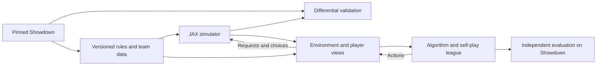

# Gen 5 Random Battles: project plan

Build a research platform that can learn exceptional Pokémon battle play through large-scale self-play, reason about concealed information, and demonstrate its strength in the actual Pokémon Showdown simulator. The platform has three independently testable construction sites: **Algorithm**, **Environment**, and **Simulator**.

The recommended destination is a JAX implementation of the complete training computation: batched battle simulation, player observations, recurrent policy inference, trajectory collection, and learning. Keep a pinned Showdown implementation as the reference that determines whether the platform is playing the right game. Use milestones and experimental evidence to choose increasingly ambitious methods; there is no calendar deadline.

This document is a proposed architecture and research program, not an implementation or a performance claim. Research was checked on October 27, 2026. The workspace currently has no indexed application code or local Showdown checkout, so implementation paths below are proposed. Hardware availability and desired deployment latency remain open configuration choices.

**Define the game before optimizing it.** The target is Showdown's `gen5randombattle`, including its team generator, inherited mechanics, format clauses, requests, information disclosure, and terminal conditions. It is more specific than “Generation 5 Pokémon mechanics.” Pin a Showdown commit, export the resolved format, and assign a version to every benchmark and checkpoint. The currently inspected format specifies the Gen 5 mod, random teams, Sleep Clause Mod, HP Percentage Mod, Cancel Mod, and Illusion Level Mod. Its listed rules do not include Team Preview. Reconfirm the effective inherited rules at the pinned revision. [Showdown format definition](https://raw.githubusercontent.com/smogon/pokemon-showdown/master/config/formats.ts)

Success has four separate dimensions:

| Dimension | What counts as success | Evidence |
|---|---|---|
| Fidelity | The supported format behaves like pinned Showdown, including information disclosure | Differential traces, mechanics tests, request parity, explicit coverage manifest |
| Efficiency | JAX makes useful training substantially faster on available hardware | Complete pipeline benchmarks, learning curves, memory and compilation measurements |
| Strength | Agents win against a diverse, independently evaluated opponent pool | Held-out tournaments on Showdown, confidence intervals, tactical tests |
| Robustness | Gains survive new teams, opponents, seeds, and targeted exploiters | Cross-play matrices, adversarial evaluations, multiple training runs |

The moonshot is an expert or superhuman Gen 5 Random Battles agent with a reusable accelerator-native simulator and a defensible research benchmark. Neither a high self-play score nor a fast approximate simulator is sufficient evidence of that outcome.

**Use existing work as evidence and potential components.** Before choosing a simulator foundation, run a focused audit of candidates against the exact Gen 5 target. Check source availability, license compatibility, mechanics coverage, observation fidelity, tests, maintainability, and measured throughput. Similar project names do not establish shared implementations or equivalent scope.

| Project or research | What it contributes | What still needs verification |
|---|---|---|
| Pokémon Showdown | Reference mechanics, generation-specific overrides, team generation, protocol | Exact pinned revision and all inherited behavior |
| Jaxcalibur | A published example of JAX Pokémon simulation, transformer self-play, hidden-state prediction, and search | Its reported results concern a different generation; the inspected write-up does not promise released engine code |
| PokeJAX research | Evidence that accelerator-oriented Pokémon translation is an active direction | Reproducible source, relevant generation, complete mechanics coverage, and benchmark semantics |
| `JerJer2465/pokejax` | A public repository described as a Gen 4 JAX engine | Gen 5 adaptation cost and correctness; do not conflate it with the research implementation |
| `poke-env` | Python integration with Showdown and baseline players | Exact request parsing, perspective fidelity, version compatibility |
| Metamon | Pokémon trajectory modeling, offline learning, replay-processing approaches | Availability and relevance of Gen 5 Random Battles data and reconstruction assumptions |
| Pgx | JAX game-environment conventions and small imperfect-information test games | It is infrastructure inspiration, not a Pokémon simulator |

The Jaxcalibur author describes PPO self-play with a JAX engine and inference-time search; this supports the plausibility of the overall direction without establishing the best approach for Gen 5. The PokeJAX paper reports large speedups, but such figures should not become this project's targets without matching workload and fidelity. [Jaxcalibur](https://jaxcalibur.github.io/), [PokeJAX research](https://arxiv.org/abs/2603.12145), [Gen 4 repository](https://github.com/JerJer2465/pokejax)

The integration and representation audit should examine the actual available APIs and datasets. [poke-env](https://github.com/hsahovic/poke-env), [Metamon](https://github.com/UT-Austin-RPL/metamon), [Pgx](https://github.com/sotetsuk/pgx)

**Give the three construction sites a common contract.** The simulator owns battle truth and mechanical transitions. The environment owns what each player can know, what they may submit, rewards, and experience records. The algorithm owns memory, beliefs, action selection, learning, and opponent selection. No algorithm should depend on the internal layout of the simulator.



The conceptual interfaces are:

```python
# Simulator: complete state, used only inside the trusted environment.
reset(teams, battle_rng, rules) -> BattleState
advance(state, submitted_choices) -> Transition

# Transition contains state, observer-scoped events, requests,
# outcome, random-state updates, and explicit diagnostic status.
# It stops at the next externally meaningful request or terminal state.

# Environment: one knowledge state per player.
update_view(view, visible_events, private_request) -> PlayerView
encode(view, feature_config) -> Observation
action_mask(view, private_request) -> ActionMask

# Algorithm: receives only permitted player information.
act(params, observation, memory, policy_rng) -> Action, Memory, PolicyInfo
learn(train_state, trajectories) -> TrainState, Metrics
```

These are semantic contracts, not final signatures. JAX implementations use fixed-shape PyTrees, arrays, enums, and explicit masks. The Showdown adapter produces the same observation contract through its protocol. Test equivalence of the adapters before sharing a checkpoint between them.

**Construction site 1: Algorithm.** Build a strong learning baseline first, then investigate equilibrium-oriented learning and planning. A complicated solver should have to beat a well-trained simpler policy under controlled evaluation.

Treat a battle as a two-player, zero-sum, partially observed stochastic game with simultaneous decisions at some requests and single-player decisions at others. A policy acts on its own observation history, not the full battle state. Both players must commit normal-turn choices without seeing the other's selection. The system must retain stochastic policies: prediction, bluffing, and mixed strategies can matter.

The research sequence is:

| Stage | Method | Why build it | Promotion criterion |
|---|---|---|---|
| A0 | Legal random, damage-oriented, and simple switching policies | Find interface bugs and establish meaningful floors | Complete battles reliably through the same player interface |
| A1 | Recurrent PPO self-play | Establish learning and measure architecture choices | Reproducible gains over baselines and historical checkpoints on Showdown |
| A2 | Opponent league plus explicit belief supervision | Reduce cycling and improve inference about concealed teams | Better cross-play and belief calibration on held-out battles |
| A3 | Regularized Nash Dynamics and population-based best-response research | Study robust mixed strategies and exploitability | Improvement under independent exploiters at matched resources |
| A4 | Belief-aware simultaneous-action search | Spend inference compute on difficult tactical decisions | Reliable gain over the same network without search |
| A5 | Search distillation and public-belief research | Convert planning into stronger fast policies and investigate deeper strategic reasoning | Improvements survive information-boundary and transfer tests |

PPO provides a practical policy-optimization starting point, not a convergence guarantee for this game. DeepNash provides motivation for testing Regularized Nash Dynamics in a large imperfect-information setting; its Stratego results do not automatically transfer to Pokémon or arbitrary neural approximations. [PPO paper](https://arxiv.org/abs/1707.06347), [DeepNash paper](https://arxiv.org/abs/2206.15378)

**Start with a structured recurrent network.** Encode the battlefield, each friendly Pokémon, each known opposing Pokémon, candidate moves, candidate switches, and recent visible events as typed entities. Use learned categorical embeddings for identities and mechanically meaningful numerical features. Attention lets actions interact with team composition and current field conditions. A recurrent memory or cached history model carries information beyond the latest observation.

Use a modest entity encoder with a GRU as the first baseline. Compare it with a transformer plus recurrent memory, then with a longer-context trajectory transformer. A reasonable experimental model-size grid is roughly 2M, 8M, and 32M parameters; these are starting proposals, not a claim that any size is optimal. Measure strength versus both environment interactions and accelerator-hours before expanding further.

Keep policy outputs tied to action entities. A move logit should depend on the move and its current user; a switch logit should depend on the candidate Pokémon and matchup. This shares useful structure across species and move combinations. Distinguish unknown, known absent, unrevealed, fainted, and unavailable values with explicit encodings.

The initial network has a masked stochastic policy head and an observation-only value head. Add auxiliary heads for unrevealed moves, items, abilities, opposing action probabilities, and outcome calibration. Hidden simulator state can supply supervised targets during training, but it cannot enter the actor's features or recurrent state. Evaluate probability calibration as well as accuracy: uncertainty is part of the decision problem.

A separate privileged critic is an optional controlled experiment. It may inspect full state to improve training estimates, but its parameters, activations, normalization statistics, and memory must not create an input path into the deployed actor. First establish a clean observation-only baseline so any gains and leakage risks are measurable.

**Make self-play a population experiment.** Maintain frozen historical checkpoints, simple specialist opponents, and independently trained agents. Sample opponents using a documented mixture of recent strength, historical diversity, and identified weaknesses. Freeze each assigned opponent for its episode; version all behavior policies in stored trajectories. Avoid updating both sides in ways that make rollout probability ratios ambiguous.

Track the full cross-play matrix. A scalar rating can conceal cycles in which one agent beats a second, loses to a third, and forgets how to beat the first. Keep a separate evaluation population that does not directly drive training. Train targeted best responses against promoted candidates, and report them as exploitability probes, not certificates of equilibrium.

Build the PPO learner with legal-action masking, recurrent sequence minibatches, burn-in or recomputed memory where appropriate, clipped updates, entropy monitoring, gradient clipping, and finite-value checks. Reconstruct recurrent state consistently during optimization; do not shuffle isolated turns and pretend they are independent. If scaling requires stale actors, explicitly measure policy lag and adopt an appropriate correction or synchronous design.

**Use terminal rewards as the reference objective.** Give each player +1 for a win, -1 for a loss, and 0 for a draw. Start with undiscounted episodic returns. A learner's rollout boundary is not a battle outcome: bootstrap from the continuing state and retain the episode's memory. Infrastructure failures are neither losses nor draws.

Damage and faint-count rewards can favor bad trades, discourage sacrifices, or create incentives to prolong battles. If shaping is explored, retain a terminal-only control and evaluate only the actual battle objective. Auxiliary prediction and curriculum tasks are preferable first experiments. Report any discounting or shaping as a change to the training objective.

**Learn beliefs that respect the team generator.** The posterior is over coherent possible teams and sets, not independent guesses for six species, four moves, an item, and an ability. Generate training examples from the pinned reference generator. Condition hypotheses on observed species, level, moves, revealed abilities/items, damage intervals, speed-order evidence, and known generation constraints.

Begin with a recurrent network that learns beliefs implicitly. Then add a finite particle representation of complete hidden configurations. Update particles with observation likelihoods, resample when weights collapse, and rejuvenate with generator-aware proposals. Track effective sample size and how often the true configuration is excluded. Treat opponent action choices as policy-dependent evidence; failure to select a move is not proof that the move is absent.

Damage evidence must account for rounded public HP and uncertain stats, items, abilities, and random rolls. Speed evidence must account for priority, effects, and ties. Illusion requires identity hypotheses rather than immediately assigning every apparent species reveal to a true team slot. Keep public history separate from any proposed hidden completion.

**Add search in increasing levels of difficulty.** The first planner estimates a joint-action payoff table over belief particles and chance samples, then computes or approximates a mixed response. A normal request has relatively few available moves and switches, making a shallow matrix calculation a useful experiment. It is only an approximation: the opponent conditions on its private information, so one universal opponent action distribution across all particles is generally insufficient.

Next, represent opponent types or information sets explicitly. Couple strategies across sampled worlds whenever a player cannot distinguish those worlds. At every simulated decision, construct that player's own view and memory; never pass the sampled full state directly into its policy. Neither side may observe the other's current committed action.

Naively solving every fully revealed sampled world and averaging the chosen actions creates strategy fusion: the planner assumes future decisions can exploit information it will never receive. Use this only as a diagnostic upper-information baseline, never as the justification for a sound deployment policy. Evaluate planning on small games where exact solutions expose such errors.

The moonshot search track is public-belief search with counterfactual values and local regret minimization, inspired by ReBeL. Learned approximate beliefs, restricted particles, limited search depth, and function approximation make this a research problem; the original method's theoretical results are not a guarantee for the proposed Pokémon implementation. [ReBeL paper](https://arxiv.org/abs/2007.13544)

Distill useful search policies into the fast actor, compare search during training with search only at inference, and allocate simulations according to decision uncertainty. Keep uncertainty calibration and information-set consistency as explicit requirements, not just win rate.

**Construction site 2: Environment.** Build the information interface with the same care as the battle engine. A simulator can have correct damage calculations and still train an invalid agent by exposing the wrong inputs.

Separate four records:

| Record | Contents | Who may consume it |
|---|---|---|
| `BattleState` | True teams, exact internal HP, hidden effects, pending actions, RNG | Simulator and explicitly privileged training/debugging code |
| `PlayerView` | Public event history plus that player's private requests and disclosures | That player's policy and belief updater |
| `BeliefState` | Inferred distributions or particles derived from that view | Policy and permitted search |
| `TrainingRecord` | Observations, masks, chosen actions, behavior probabilities, outcomes, optional labels | Learner with enforced input/target separation |

Use Showdown's player-visible streams and request objects as the observation authority. Its protocol distinguishes battle events, private choice requests, and decisions; use those distinctions directly rather than reconstructing visibility from assumptions about the cartridge game. [Showdown simulator protocol](https://raw.githubusercontent.com/smogon/pokemon-showdown/master/sim/SIM-PROTOCOL.md)

**Advance from request to request.** Do not assume one environment step is one full turn. Encode the request kind, which players must act, and which choices are already privately committed. Normal move requests, pivot replacements, faint replacements, and other interruptions require different handling. Process automatic mechanics until another external choice is needed or the battle ends.

When both players act, compute both observations before either chosen action can affect the other's view. A pending action remains private. When only one acts, the other contributes no policy action. Both players can still receive visible events and update their memory during that interval.

For learning, keep rewards and values in a fixed player's perspective. Do not negate values at every scheduler transition: consecutive requests can belong to the same player. Exclude wait/no-choice records from policy and entropy losses while preserving observations and reward propagation. If decision intervals vary and discounted experiments are added, define what elapsed quantity the discount measures.

**Use a compact request-aware action schema.** The initial singles representation reserves four move slots, six team-slot switches, and an explicit Struggle action: eleven policy slots. Active/fainted switch destinations and unavailable moves are masked from the permitted request. Forced continuation or recharge behavior is mapped according to the actual reference request, with a deterministic sole action when required. Finalize these mappings with protocol fixtures before freezing the schema.

An inactive player's WAIT is a scheduler marker, not a learnable action. No all-masked softmax is allowed: an all-masked acting request is an adapter error that must be surfaced. Do not silently substitute a random move.

Crucially, a mask represents what the player is permitted to submit based on their request, not every restriction secretly known to the simulator. Concealed trapping or other hidden restrictions can affect submission, rejection, or redisclosure behavior. Reproduce the reference request and retry semantics instead of leaking hidden facts through a perfect legality mask. Distinguish an accepted command, a rejected command, and an executed battle action.

**Encode knowledge, including uncertainty.** Candidate features include:

| Feature family | Examples and constraints |
|---|---|
| Own team | Request-visible identities, levels, HP, stats, moves/PP, items, abilities; preserve hidden internal counters as unknown when necessary |
| Opposing team | Revealed identities, apparent identities, public HP representation, observed moves, revealed item/ability, known status |
| Field and sides | Visible weather, hazards, screens, public turn count, active entities, known effect durations |
| Action context | Move type/category/power/accuracy/priority, current PP, candidate switch features, request kind |
| Temporal evidence | Visible move order, switches, failures, damage intervals, item consumption, ability disclosures |
| Beliefs | Probabilities or intervals over unknown moves, stats, sets, unrevealed members, and relevant counters |
| Derived matchups | Damage ranges and speed probabilities calculated from permitted knowledge and explicit assumptions |

Exact enemy HP, true unrevealed moves, unrevealed reserve identities, concealed duration counters, generator seed, battle RNG, and the opponent's pending action must not appear in actor inputs. Derived features are subject to the same restriction as raw fields. A perfect damage calculator using the true enemy item is still a leak.

Opponent roster entries should use encounter/reveal identity, with hypotheses for ambiguities, rather than expose hidden original slot indices. Preserve meaningful team order: order can affect mechanics. Only apply permutation augmentation when its equivalence is proven and all action mappings and order-sensitive features remain correct.

Maintain durable knowledge separately from a short event window. Truncating recent events must not erase a revealed item or known move. Recurrent training should carry state across rollout chunks and reset only when appropriate for a new episode; an opponent's newly revealed information must not reset the other player's history.

**Treat non-leakage as an executable property.** Construct pairs of full states or histories that produce the same player-visible history and request but differ in concealed information. Under the same policy RNG and permitted memory, require identical observations, masks, derived features, and action distributions. The histories must actually be observationally equivalent; changing a secret that would already have produced a visible event is not a valid test pair.

Add targeted tests for exact versus rounded HP, undisclosed items, alternate hidden reserve teams, Illusion, trapping, forced switches, and pending commitments. For search, require equal strategies across indistinguishable information sets, including at future nodes. Keep trusted-state types out of the normal policy API and run a separate trace audit of training-only labels.

**Build data and curricula without changing the final benchmark.** Partition generator seeds, full teams, battle seeds, and opponent checkpoints into train, validation, and locked test sets. Keep complete test trajectories out of replay pretraining and hyperparameter selection. Historical public replays can help, but they are not omniscient ground truth: reconstruct each player's knowledge only from what was available then, and mark uncertain labels instead of filling them from later reveals.

Use curriculum tasks to isolate competence: simple damage races; switching and hazards; setup and recovery; status and weather; PP management; incomplete information; and full random teams. Smaller teams and restricted move pools are useful diagnostic environments. They must be explicitly named variants, never silently mixed into claims about full Gen 5 Random Battles. Sample rare mechanics deliberately for testing and curriculum, while retaining the natural generator distribution for the primary evaluation.

The environment's concrete deliverables are a versioned schema, a Showdown adapter, a JAX adapter, an information-boundary suite, a replayable trajectory format, baseline agents, and a deterministic evaluation runner. This work can begin against Showdown before the JAX simulator is complete.

**Construction site 3: Simulator.** Reimplement the battle execution model for accelerators while preserving the reference's semantics. A literal line-by-line translation of Showdown's object model and callback machinery is unlikely to be the best GPU design. Preserve its observable behavior, arithmetic, random decisions, and ordering through a smaller explicit execution model.

**First resolve the complete rules dependency graph.** Gen 5 is not contained entirely inside the Gen 5 directory: its inspected scripts explicitly inherit Gen 6, and its random-team class extends the Gen 6 generator. Follow inheritance through the relevant engine, data, and rules layers. Export fully resolved species, moves, abilities, items, types, and numeric parameters from the pinned reference; retain provenance for every override. Exporting data does not translate executable callbacks, which require separate implementation and validation. [Gen 5 scripts](https://raw.githubusercontent.com/smogon/pokemon-showdown/master/data/mods/gen5/scripts.ts), [Gen 5 team generator](https://github.com/smogon/pokemon-showdown/blob/master/data/random-battles/gen5/teams.ts)

Maintain a mechanics ledger with the reference implementation, generation-specific behavior, possible triggers, implementation status, and tests for each mechanic. Derive coverage from reachable interactions, not just the initial team move pools. Copied moves, called moves, transformed identities, item exchanges, and other indirect effects can expand what a random team can encounter. A finite sample of generated teams cannot prove an effect unreachable.

The first full release supports the closure of mechanics reachable in the pinned format. Every unsupported effect is explicit. Restricted-development modes may refuse unsupported battles, but their performance and strength must be labeled as restricted. Do not silently discard those teams from a full-format evaluation or turn unknown effects into no-ops.

**Represent state as fixed arrays with explicit structure.** Use a PyTree of typed arrays with a leading batch dimension. The core roster dimensions are two sides, six Pokémon per side, and four move slots per Pokémon. Keep immutable dex tables separate from mutable battle state. Encode IDs with integers and effects with fixed slots, bitsets, counters, and masks as appropriate.

State includes current and original identities where needed, stats, HP, PP, boosts, statuses, volatile effects, items, ability state, side conditions, field conditions, active slots, request state, pending choices, action ordering metadata, and RNG state. Reserve explicit representations for transformations and copied move information. Avoid embedding Python objects or strings in compiled transitions.

Event queues, visible-event buffers, and temporary effect storage require justified capacities. Where a bound is not proven sufficient, detect overflow and return a diagnostic status with a resumable state if possible. The harness must stop or resolve it through an exact reference path; it cannot drop the event or pretend the battle ended. Any fallback usage is measured and disqualifies an “entirely device-resident” throughput claim for that run.

JAX's staged computations require deliberate treatment of data-dependent shapes and control flow. Padding, masks, and structured loops make the implementation compilable, but their costs must be profiled. [JAX control-flow documentation](https://docs.jax.dev/en/latest/201/control-flow.html)

**Use an explicit event and request state machine.** Separate command acceptance from action execution. Represent move priority, speed ordering, tie-breaking, effect precedence, mid-action interruptions, faint processing, replacements, residual effects, and next-request emission as inspectable phases. A scheduler step should preserve enough state to pause and resume correctly.

Start from a readable scalar implementation using the same array schema. Compare each phase with reference traces, then vectorize. Evaluate two accelerator execution strategies: a fixed masked sequence of common phases and a bounded event interpreter. A hybrid is likely useful: fixed phases for common effects, explicit handlers for exceptional mechanics. Select the design through benchmarks and coverage, not aesthetic preference.

Avoid a giant dispatch that computes every move, ability, and item branch for every battle. Group effects into semantic primitives such as damage, healing, status application, stat modification, switching, field updates, and conditional callbacks. Reuse primitives, but retain special handlers where Gen 5 semantics demand them.

Under `vmap`, `lax.cond` over batched predicates can become selection logic that evaluates both branches. Writing a conditional does not guarantee that inactive work disappears. Profile homogeneous and heterogeneous batches, especially rare expensive effects. Bucket by phase or effect family only when the routing cost is justified. [JAX `lax.cond` documentation](https://docs.jax.dev/en/latest/_autosummary/jax.lax.cond.html)

**Make arithmetic fidelity a first-class requirement.** Implement HP, PP, stat stages, damage rounding, modifier ordering, probabilities, and integer overflow behavior to match the reference. Use integer or explicitly specified fixed-point calculations where needed. Choose intermediate widths from worst-case bounds; compact storage types need not be the arithmetic types. Neural mixed precision is independent of battle arithmetic precision.

Generation-sensitive tests should cover weather persistence, type interactions, critical hits, status behavior, move-specific effects, ability interactions, item triggers, and clauses. Build expected values from pinned reference traces and carefully reviewed mechanics cases rather than importing assumptions from a later-generation damage calculator.

**Support two randomness modes.** The default correctness mode reproduces the pinned reference PRNG algorithm, state evolution, bounded sampling, and draw consumption order. A shared numeric seed is not enough when two engines consume draws differently. If the reference requires arithmetic awkward on the GPU, implement exact limb arithmetic or another verified equivalent.

Instrument the reference to record random decisions with their context, requested range, and position in the sequence. A diagnostic random tape can drive both implementations, but it must fail when the call structure diverges; matching only successive numeric values can hide the real bug. Keep team-generation randomness, battle randomness, policy sampling, and training randomness separate and reproducible.

A later throughput-oriented mode may use JAX-native randomness after distributional validation, but it then makes a weaker equivalence claim than exact seeded trajectories. Version that choice. Seeds are never policy features. Test independence across lanes, episode resets, devices, and cloned search states.

**Treat random-team generation as part of the environment distribution.** Initially generate a large, continuously replenished stream of teams with pinned Showdown, storing complete sets, order, provenance, and generator version. Feed teams through a device-side reset pool. This lets the battle kernel and learning loop become device-resident before rewriting the irregular generator.

Sampling the same finite pool forever changes training and invites memorization. Track reuse, refresh it, and maintain separate evaluation streams. Do not replace the generator with independent species or moveset marginals: the generator includes correlated construction decisions.

The full-JAX destination includes an on-device generator if it is desired or reset throughput justifies it. Port the resolved generator logic exactly where practical. Validate seeded outputs when using compatible randomness, and separately check species/set frequencies, team correlations, levels, ordering, and rejection behavior. A learned team sampler is an optional research approximation with its own benchmark label, not an equivalent replacement by default.

The same rule applies to the overall stack: CPU-based reference testing, orchestration, file I/O, and network transport are appropriate. The performance objective is to remove host crossings from the repeated training computation. Running a WebSocket parser or writing a checkpoint in JAX adds little to that objective.

**Build a differential verification laboratory.** The lab is a central project artifact, not a late test pass. It should support replay from initial conditions, targeted state fixtures with validated invariants, first-divergence reports, and automatic reduction of failing action sequences.

| Validation layer | What is compared | Required outcome |
|---|---|---|
| Primitive | Damage, rounding, modifiers, status timers, sampling primitives | Exact agreement on reviewed boundary cases |
| Interaction | Ordered combinations of moves, abilities, items, field effects | Matching state changes and observer-scoped events |
| Request | Who acts, allowed submissions, rejection/retry behavior | Matching player-visible requests and masks |
| Trajectory | Full battles with coupled choices and randomness | No unexplained first divergence |
| Information | Equivalent player histories with different hidden states | Identical policy inputs and permissible action behavior |
| Distribution | Uncoupled simulations and generated teams | Predeclared statistical tests and sufficient sample sizes |
| Policy transfer | Same policy and opponent evaluated on both engines | Confidence interval within a predefined acceptable gap |

Canonical comparisons should include mechanically relevant hidden state in the trusted harness, not only visible logs. An incorrect counter may produce identical logs now and a different outcome later. Compare only semantically equivalent fields; irrelevant object layout or text formatting need not match.

Use property tests for HP/PP bounds, legal transitions, state persistence, replay determinism, and zero-sum outcomes. Add metamorphic tests such as player relabeling with correctly transformed RNG/tie-breaking semantics. Build interaction tests for hazards with switches and fainting, recoil with simultaneous knockouts, substitute with status moves, item loss with ability activation, and interrupted turns. Prioritize combinations actually reachable in the format, while documenting exploratory cases beyond it.

Differential fuzzing should combine random legal play, scripted tactical policies, and learned agents. Learned agents can discover simulator exploits that random play rarely triggers. Every discovered bug becomes a minimized regression fixture and a mechanics-ledger entry. Mutate selected handlers deliberately to check that the suite detects wrong priority, rounding, effect order, and visibility.

Zero observed mismatches is evidence about tested coverage, not proof of equivalence. Report battle counts, decision counts, triggered effects, pairwise interaction coverage, and untested areas. Set transfer equivalence margins before evaluation; failure to detect a statistically significant gap is not itself evidence of equivalence.

**Optimize the complete training computation.** Start with single-device execution and use `vmap` across battles and `lax.scan` across bounded rollout chunks. Keep simulator state, player memory, network parameters, and rollout buffers resident on the device. Reset completed lanes from prepared team pools, preserve terminal observations, and mask finished segments correctly. Avoid resetting every lane because one battle ends.

Sweep batch size and rollout length, then measure state memory, trajectory memory, activation memory, compiler time, and the fraction of time spent in simulation, features, inference, optimization, and resets. Structured observations or event deltas may be cheaper to store than large derived tensors. Recompute derived features only if the memory savings justify the extra work.

Benchmark three workloads separately: simulator-only execution, rollout including observation and policy inference, and complete training including optimizer updates. Report decisions per second, completed battles per second, useful non-padding work, and strength gained per accelerator-hour. A turn, a player decision, and a scheduler event are different units.

Warm up compiled functions, synchronize device completion when timing, and report compilation and steady-state measurements separately. Include ordinary and long/rare-effect battles. Compare with a properly batched CPU Showdown reference under a documented resource budget. [JAX benchmarking guidance](https://docs.jax.dev/en/latest/benchmarking.html)

Scale to multiple accelerators only after profiling a useful single-device configuration. Shard independent battles first; measure communication and opponent-parameter storage costs. Use population batching where each cohort can share a checkpoint instead of requiring a different huge model for every lane. Explore custom JAX kernels only for measured bottlenecks with an independent conformance suite.

No headline speedup is promised. If exact JAX execution is slow, isolate whether the cause is branching, memory bandwidth, event scheduling, feature extraction, or network inference. A CPU reference plus JAX learner remains useful while the simulator matures. A compiled CPU engine is a comparison and possible engineering fallback, not a silent substitution for the stated full-JAX research track.

**Evaluate strength on an engine the agent cannot redefine.** Promoted agents play their scored benchmark games on pinned Showdown through the same observation adapter used for deployment. Maintain the JAX benchmark for speed and debugging, but use reference-engine results for primary capability claims.

Construct a fixed tournament suite with random and heuristic baselines, independently seeded learned policies, historical champions, style specialists, and search opponents when compatible implementations are available. Keep a locked final opponent/test set. Include curated tactical positions for switching, hazards, recovery, setup, concealment, and endgame planning.

For team variance, pair team allocations and exchange player sides across matches; repeat with independent battle seeds. This reduces some variance without making outcomes deterministic or perfectly matched. Cluster confidence intervals by paired matchup, report draws and failures, and distinguish battle-seed uncertainty from training-run uncertainty. For expensive comparisons, choose sample size from a target confidence width and a predeclared stopping rule. Use at least several independent training seeds for major claims when feasible.

Measure win rate, cross-play stability, calibration, invalid submissions, timeout rate, decision latency, and performance on rare mechanics. Freeze the opponent during best-response training and evaluate the resulting exploiter on held-out teams. A successful exploiter demonstrates a weakness; an unsuccessful one does not prove that no stronger exploiter exists.

Optional human matches and public-server play come after local transfer and latency validation, following the service's rules at that time. Pin or record the actual server version when possible and distinguish live-server format drift from the frozen benchmark. Ladder placement is supplementary evidence, not a stable reproducible research metric.

**Execute the project through acceptance gates, with no fixed dates.** Each milestone produces something useful even if a later research direction fails. The three sites can progress concurrently once their contracts are settled, but expensive training waits for the relevant correctness gates.

| Gate | Main work | Reviewable deliverables | Acceptance condition |
|---|---|---|---|
| G0: Specification | Pin Showdown; audit reuse; resolve rules and data | Benchmark charter, source/version manifest, mechanics ledger, reuse decision | Exact target and known coverage gaps are explicit |
| G1: Reference environment | Implement protocol views, actions, fixtures, baselines | Showdown adapter, trajectory schema, baseline tournament | Complete reference battles; request and visibility tests pass |
| G2: Learning proof | Train recurrent policy against reference or declared restricted backend; validate algorithms on small games | Reproducible PPO run, recurrent-state tests, learning curves | Learning beats fixed baselines on held-out reference matches |
| G3: Simulator slice | Implement battle/request state machine and representative mechanics | Scalar and batched kernels, coupled RNG harness, profiler report | Exact differential parity for the declared slice; plausible GPU execution |
| G4: Full-format simulator | Complete reachable mechanics, generator integration, fuzzing | Coverage report, regression corpus, full battle traces | No known reachable unsupported effects; no unresolved correctness failures |
| G5: End-to-end training | Integrate device-resident rollout, features, inference, learner | Benchmark harness, reset pools, checkpoints, transfer report | Measured useful training speedup and reference-transfer equivalence within the chosen margin |
| G6: Strong baseline | Scale PPO, tune architecture, build opponent league | Multi-seed results, cross-play matrix, belief ablations | Robust improvement across the independent evaluation suite |
| G7: Strategic research | R-NaD, best responses, belief particles, simultaneous search | Controlled comparisons, small-game solver tests, exploitability probes | Benefits exceed complexity and resource costs under declared metrics |
| G8: Moonshot system | Public-belief planning, search distillation, adaptive compute | Best agent, reproducible release, complete audit and benchmark report | Strongest verified Gen 5 performance achieved within the explored design space |

G2 and G3 can proceed after G1 in parallel as engineering work. G4 and G5 inform one another: performance prototypes happen early, while full-format performance claims wait for coverage. G6 does not require successful G7/G8 research. The full-JAX generator can be pursued during G4/G5 without blocking faithful training using reference-generated teams.

**Keep experiments discriminating.** Every expensive run should answer a question that changes the design. Begin with the following comparisons:

| Question | Controlled comparison | Decision it informs |
|---|---|---|
| Does memory matter? | Feed-forward versus recurrent policy with equalized capacity | Minimum architecture and history handling |
| Are handcrafted matchup features worth their cost? | Raw structured state versus permitted damage/speed features | Feature pipeline complexity and throughput |
| Do explicit beliefs improve decisions? | Implicit memory versus auxiliary prediction versus particles | Whether belief machinery belongs in deployment |
| Is more model capacity worthwhile? | Size sweeps at matched interactions and matched accelerator-hours | Scaling strategy |
| Does a league reduce cycling? | Latest-self-play versus checkpoint mixture versus population selection | Opponent infrastructure |
| Does equilibrium-oriented learning help? | PPO versus R-NaD with comparable representation and compute | Main learning algorithm |
| Does planning add robust strength? | Same checkpoint with no search, shallow matrix search, deeper belief-aware search | Inference compute and search investment |
| Does privileged training help safely? | Observation critic versus isolated full-state critic | Training-only information use |
| Does replay pretraining transfer? | Self-play from scratch versus matched pretraining variants | Data investment and initialization |

For each comparison record the primary metric, evaluation set, compute accounting, uncertainty, and promotion criterion before running it. Keep a small permanent sanity suite of matrix games and partially observed games with known solutions for debugging mixed strategies, memory, and search independently of Pokémon mechanics.

**Organize implementation around ownership and artifacts.** A proposed repository layout is:

```text
reference/        # Pinned Showdown dependency, oracle instrumentation, exports
rules/            # Versioned format manifest and compiled immutable tables
simulator/        # State, arithmetic, scheduler, effects, RNG, batched kernels
environment/      # Player views, requests, encodings, actions, rewards, adapters
agents/           # Baselines, networks, memory, beliefs, planners
training/         # PPO, R-NaD experiments, league, rollout, distributed execution
evaluation/       # Reference tournaments, confidence intervals, tactical suites
tests/            # Mechanics, interactions, differential, visibility, regressions
benchmarks/       # Simulator, rollout, end-to-end training, memory/compile profiles
experiments/      # Versioned configurations and machine-readable run manifests
docs/             # Contracts, mechanics ledger, decisions, benchmark reports
```

Each checkpoint records model/optimizer state, training RNGs, relevant episode state or restart policy, league composition, rules hash, Showdown commit, feature/action schema versions, generator provenance, software versions, and experiment configuration. Test resumption rather than assuming that saving network weights reproduces training. Store large datasets and checkpoints outside Git with immutable identifiers.

Use fast deterministic checks for every change, larger interaction/differential suites for mechanics changes, and full transfer/performance runs for release candidates. Continuous integration should catch schema changes, visibility regressions, unsupported effects, and failed fixtures before they contaminate expensive training. Keep deliberate schema migrations and compatibility errors readable.

**Address the largest risks with concrete exit routes.**

| Risk | Early signal | Response |
|---|---|---|
| Long tail of mechanical bugs | Trace mismatches cluster around rare combinations | Expand event tracing and minimized fixtures; delay full-format claims |
| Hidden-information leakage | Equivalent histories produce different features or policies | Repair the view boundary; invalidate affected comparisons and retrain where needed |
| JAX compilation or branching overwhelms gains | Large compile times, poor useful throughput | Profile and restructure phases, tables, dispatch, or batch cohorts |
| Policies exploit simulator errors | JAX strength fails to transfer to Showdown | Localize first divergences under learned play; repair and repeat evaluation |
| Self-play cycles | New checkpoints lose to old specialists | Expand historical population and targeted best-response training |
| Beliefs exclude the true hidden state | Particle collapse or overconfident wrong predictions | Improve proposals, retain uncertainty, calibrate on held-out traces |
| Search invents knowledge | Different actions at indistinguishable simulated histories | Enforce information-set coupling; return to a simpler valid planner |
| Generator or server drifts | Updated teams/rules change results | Freeze old benchmark; publish a new version and explicit transfer study |
| Resource use grows without strength | Larger runs only improve training reward or raw throughput | Revisit representation, evaluation, and bottlenecks before scaling |

**The first implementation package should make the project testable.** Produce the pinned reference setup, an exported target-format manifest, a mechanics ledger, example request traces, the player-view/action schema, a baseline reference tournament, and a minimal differential harness. Then build a simulator slice spanning a normal simultaneous turn, a forced replacement, a pivot interruption, status/residual effects, and one concealed-information case. That slice should exercise the architecture rather than maximize the number of move names implemented.

The long-term research opportunity is the combination: a faithful accelerator-native battle engine enables enormous self-play; an exact information interface makes those experiences legitimate; and a strong learning system can use both training compute and inference compute to discover strategies. All three construction sites should remain independently inspectable so that a gain in one can be trusted by the others.
